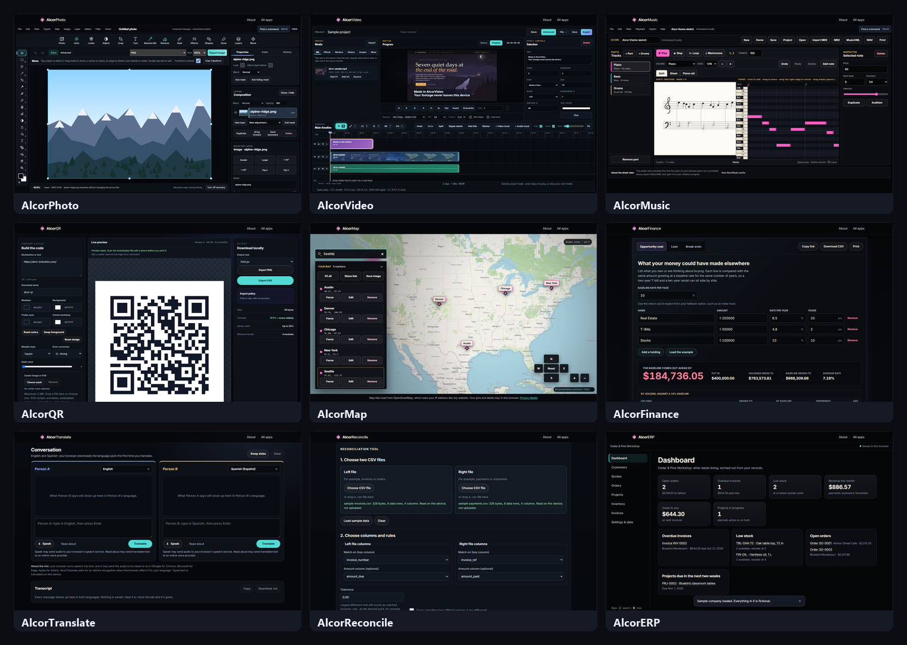

# AlcorApps

Nine free browser apps, from a layered photo editor to a small-business back office, that run
entirely on your device. There is no account and no upload: the files you open never leave the
browser. Each app is plain JavaScript, HTML and CSS, with no framework and no build step.



| App | What it does | Hard part worth reading |
|---|---|---|
| [AlcorPhoto](web/AlcorPhoto) | Layered photo editor: masks, brushes, selections, filters, background removal. Opens PSD; exports PNG, JPEG, WebP, GIF, TIFF and more. | Copy-on-write tile storage for undo; codecs written from scratch |
| [AlcorVideo](web/AlcorVideo) | Multi-track video editor: 12 video and 12 audio tracks, keyframes, color grading, titles. Exports MP4 or WebM. | Whole render and export pipeline in the browser |
| [AlcorMusic](web/AlcorMusic) | Piano roll, score preview and playback. Exports MIDI, MusicXML and WAV. | Synthesized instruments; MIDI and WAV written by hand |
| [AlcorQR](web/AlcorQR) | QR code designer with logo, colors and module styles. PNG up to 4096 px or SVG. | Contrast checks so codes still scan; untrusted SVG logos |
| [AlcorMap](web/AlcorMap) | Labeled markers, coordinate entry, share links, GeoJSON/CSV/PNG export (MapLibre GL). | Whole map encoded in a share link, no server |
| [AlcorFinance](web/AlcorFinance) | Opportunity cost, loan schedules and break-even analysis. | Strict number parsing and cent-exact rounding |
| [AlcorTranslate](web/AlcorTranslate) | Two-person conversation translator. | Browser translator with a WebAssembly fallback in a worker |
| [AlcorReconcile](web/AlcorReconcile) | Compares two CSV exports and flags matches, mismatches and missing records. | BigInt money math; CSV-injection-safe export |
| [AlcorERP](web/AlcorERP) | Customers, quotes, orders, projects, stock and invoices as one record. | Stock as a movement ledger; derived dashboard |

Each app's folder has a README that explains how it works and which code to read first.
Full-size screenshots are in [`screenshots/`](screenshots).

## Highlights

- **Engines are split from the UI.** Files named `*-core.js` hold pure logic with no DOM, storage
  or network access, so they also load under Node. UI files wire them to the page.
- **One shared shell.** AlcorPhoto, AlcorVideo and AlcorMusic share one runtime
  ([`alcor-app.js`](web/assets/js/alcor-app.js)) for the title bar, app tabs, menus, keyboard
  routing and local project storage. The shell has no network access of its own; each app owns its
  engine.
- **Heavy work off the main thread.** AlcorPhoto's pixel engine, MapLibre's renderer and the
  translation engine run in Web Workers (background threads), so the page stays responsive.
- **Local persistence only.** Projects live in page memory, IndexedDB, `localStorage` or files you
  download.
- **Exact money math.** AlcorFinance rounds to cents at defined points, and AlcorReconcile parses
  amounts into `BigInt` integers, so totals never drift by a floating-point error.

## Run them

Any static file server works. From this folder:

```sh
python -m http.server --bind 127.0.0.1 --directory web
```

Open the address it prints, followed by an app folder, for example `/AlcorPhoto/`. Opening
`index.html` straight from disk does not work, because browsers block modules and workers on
`file://` pages.

## Tests

Check that every file each page loads is present (Python standard library only):

```sh
python tools/check_assets.py
```

It prints one line per app and ends with `9/9 apps complete`.

## Limitations

- **AlcorMap** draws its background map from OpenStreetMap tiles, so that layer needs a network
  connection. Markers, search, sharing and exports work offline.
- **AlcorTranslate** works out of the box in Chrome and Edge through their built-in translator. In
  other browsers it falls back to Bergamot, which needs its language models (listed in
  [`models.json`](web/assets/lib/bergamot-translator/models.json)). They are large and not included.

## Third-party code

- [MapLibre GL JS](web/assets/lib/maplibre-gl) (BSD-3-Clause), see its `LICENSE.txt`.
- [Bergamot translator](web/assets/lib/bergamot-translator) (MPL-2.0), see `LICENSE.txt` and `LICENSES.md`.
- QR engine in [`js/vendor`](web/assets/js/vendor) (MIT and Apache-2.0), see `THIRD_PARTY_NOTICES.md`.
