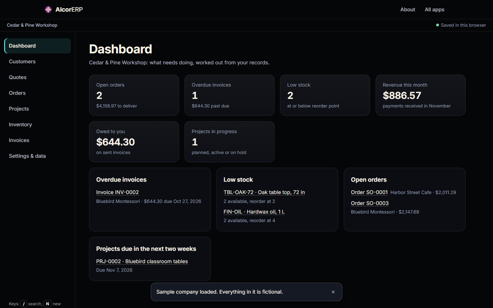

# AlcorERP

A small-business back office in the browser: customers, quotes, orders, projects, stock and
invoices, connected as one record, with a dashboard of what needs doing. No account and no server.

## How it works

| File | Role |
|---|---|
| `alcor-erp/erp-core.js` | Data model, validation, money and quantity handling, sample company. No DOM. |
| `alcor-erp/erp-app.js` | Views, forms and the dashboard. |

Data is saved in the browser. A JSON backup can be exported and imported into this or any other
browser.

## The hard parts

- **One record, many views.** A quote converts to an order (`convertQuote`) and an order to an
  invoice (`invoiceFromOrder`). The dashboard (overdue invoices, low stock, open orders, projects
  due) is computed from those records rather than stored separately.
- **Stock as a ledger.** Stock levels are never edited directly: on-hand quantity is the sum of
  recorded stock movements, and open orders reserve quantity, so "available" is always derived
  and auditable.
- **Money and quantities without surprises.** `parseMoney`, `parseQty` and per-currency
  `formatMoney` with `validCurrency` keep amounts exact and consistently displayed.
- **Safe imports.** `parseBackup` checks a backup and `normalizeRecord` cleans every record before
  anything replaces your data.

## Run

Serve `AlcorApps/web` with any static server, open `AlcorERP/` and choose
**Load sample company**. Every name in it is fictional.
