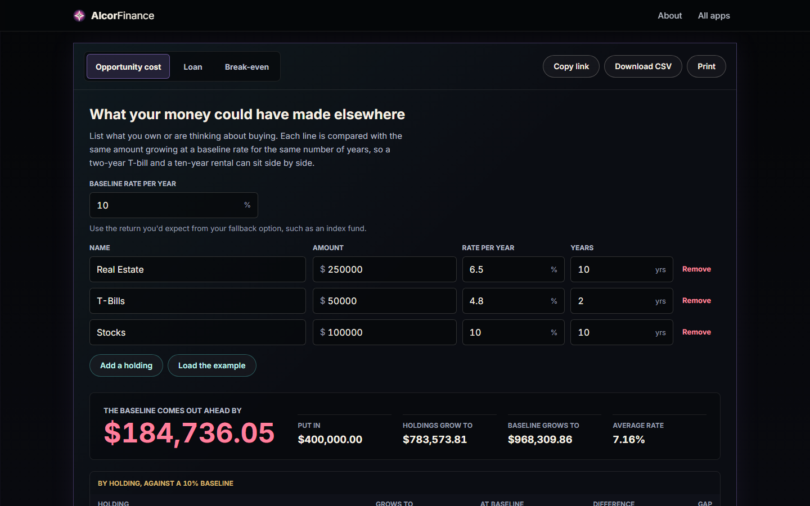

# AlcorFinance

Three small calculators that answer real questions: **opportunity cost** (what your money could
have made elsewhere), **loan** schedules, and **break-even** analysis. Results can be copied as a
link, downloaded as CSV or printed.

## Highlights

- **Money that adds up.** Amounts are rounded to cents at defined points (`roundCents`) and
  formatted consistently (`formatMoney`, `formatPercent`), so tables and totals agree.
- **Strict number parsing.** `parseNumber` accepts currency signs and thousands separators but
  rejects ambiguous input such as misplaced commas (`hasBadComma`). The user gets a clear message
  (`numberError`) instead of a silently wrong answer.
- **Bounded inputs.** `checkAmount`, `checkRate` and `checkGrowthYears` keep results meaningful.

## How it works

[`alcor-finance-core.js`](../assets/js/alcor-finance-core.js) holds the math and validation with
no DOM; [`alcor-finance.js`](../assets/js/alcor-finance.js) is the UI. State lives in the page and
the share link, never on a server.

## Run it

Serve `AlcorApps/web` with any static server (see the [AlcorApps README](../../README.md)) and
open `AlcorFinance/`. An example is loaded.
