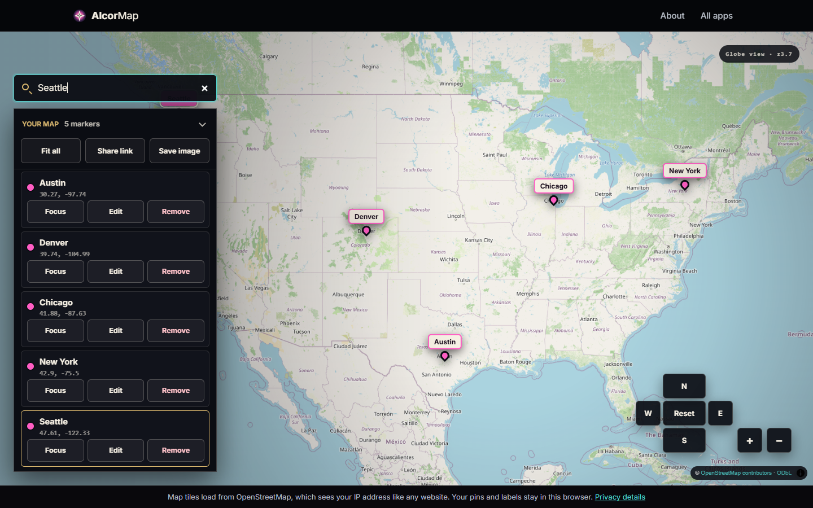

# AlcorMap

A simple map maker: search for a place or type coordinates, drop labeled markers, then share the
whole map as a link or export it as GeoJSON, CSV or a PNG image.

## Highlights

- **Share links with no server.** `alcorMapEncodeShare` packs the markers into the URL itself and
  `alcorMapDecodeShare` restores them, validating every field on the way in.
- **Forgiving input, strict storage.** `alcorMapParseCoordinates` accepts the common ways people
  write coordinates; `alcorMapNormalizeMarker` and `alcorMapWrapLongitude` keep stored data valid.
- **Round-trip GeoJSON** (the standard JSON format for map features) through `alcorMapToGeoJSON`
  and `alcorMapFromGeoJSON`.
- **Place search without a geocoding service.** A built-in place list answers city searches
  offline.

## How it works

| File | Role |
|---|---|
| [`alcor-map-core.mjs`](../assets/js/alcor-map-core.mjs) | Pure helpers: coordinate parsing, marker validation, state, share links, GeoJSON. |
| [`alcor-map-places.mjs`](../assets/js/alcor-map-places.mjs) | The built-in place list for city search. |
| [`alcor-map.mjs`](../assets/js/alcor-map.mjs) | The UI on top of MapLibre GL JS. |

The background map tiles come from OpenStreetMap, so that layer needs a network connection.
Markers, search, sharing and exports work offline.

## Run it

Serve `AlcorApps/web` with any static server (see the [AlcorApps README](../../README.md)) and
open `AlcorMap/`.

MapLibre GL JS is BSD-3-Clause licensed; its license is in
[`assets/lib/maplibre-gl`](../assets/lib/maplibre-gl).
