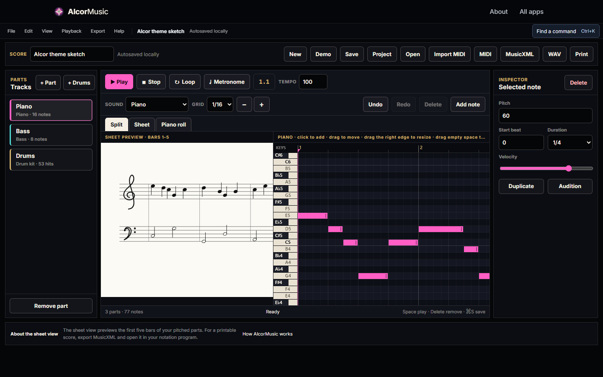

# AlcorMusic

A piano roll with live score preview, multi-part playback and export to MIDI, MusicXML and WAV.
Everything, including sound synthesis, happens in the browser.

## How it works

`alcor-music.js` has two halves. The **engine** section is pure logic (synthesis, file formats,
patterns) with no DOM, storage or network, so tests can load it alone. The **UI** section draws
the piano roll and score and drives playback through the Web Audio API.

## The hard parts

- **Synthesis from first principles.** Instruments are generated, not sampled: a plucked-string
  model (`vPluck`), PolyBLEP band-limited oscillators (`blep`) to avoid aliasing, and a noise
  generator (`noiseGen`) for drums.
- **File formats written by hand.** `parseMidi` and `midiBytes` read and write Standard MIDI
  Files, `wavBytes` renders audio to WAV, and MusicXML export produces notation other programs open.
- **Two views of one project.** The piano roll and the sheet preview edit the same notes, at 480
  ticks per quarter note, with hard limits on project length and render time.

## Run

Serve `AlcorApps/web` with any static server and open `AlcorMusic/`. The theme sketch loads
with notes already in it; press **Play**.
