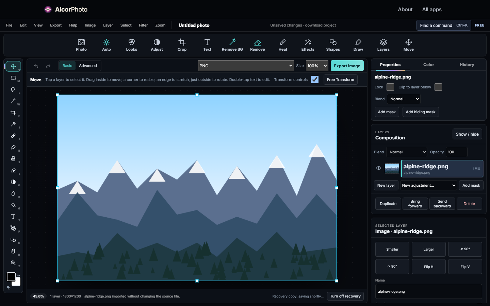

# AlcorPhoto

A layered photo editor that runs entirely in the browser: layers and masks, brushes, selections
(magic wand, polygonal lasso), adjustment layers, filters, background removal and crash recovery.

## Highlights

- **Undo that scales.** Painted pixels live in 256 px tiles with copy-on-write versions. A stroke
  copies only the tiles it touches, so history memory grows with the edit, not the image size.
- **Codecs in plain JavaScript.** BMP, TIFF, GIF (including animated), ICO and TGA are encoded and
  decoded by hand (`encodeGif`, `lzwEncode`, `medianCut` for palette quantization, `decodeTiff`).
  PNG, JPEG, WebP and AVIF go through the browser.
- **Safe PSD reading.** `decodePsd` reads the composite image of PSD and PSB files with caps on
  dimensions and pixel count. It accepts only raw or PackBits data and refuses anything else.
- **Responsive on big images.** Heavy pixel work runs in a Web Worker so the UI never freezes.

## How it works

| File | Role |
|---|---|
| [`alcor-photo.js`](../assets/js/alcor-photo.js) | Editor: wires the document model, rendering and the shared app shell together. |
| [`alcor-photo-core.js`](../assets/js/alcor-photo-core.js) | Document model and project schema. No DOM, so it also runs under Node. |
| [`alcor-photo-studio.js`](../assets/js/alcor-photo-studio.js) | Pixel tools, selections, masks, history and shortcuts. |
| [`alcor-photo-pixels.js`](../assets/js/alcor-photo-pixels.js) | Pixel engine (filters, flood select, blur), run in a Web Worker. |
| [`alcor-photo-raster.js`](../assets/js/alcor-photo-raster.js) | Versioned tile storage for painted pixels. |
| [`alcor-photo-formats.js`](../assets/js/alcor-photo-formats.js) | Image codecs written from scratch. |
| [`alcor-photo-psd.js`](../assets/js/alcor-photo-psd.js) | PSD/PSB reader, loaded only when you open one. |
| [`alcor-photo-recovery.js`](../assets/js/alcor-photo-recovery.js) | Crash recovery copy in IndexedDB. |

## Run it

Serve `AlcorApps/web` with any static server (see the [AlcorApps README](../../README.md)) and
open `AlcorPhoto/`.
