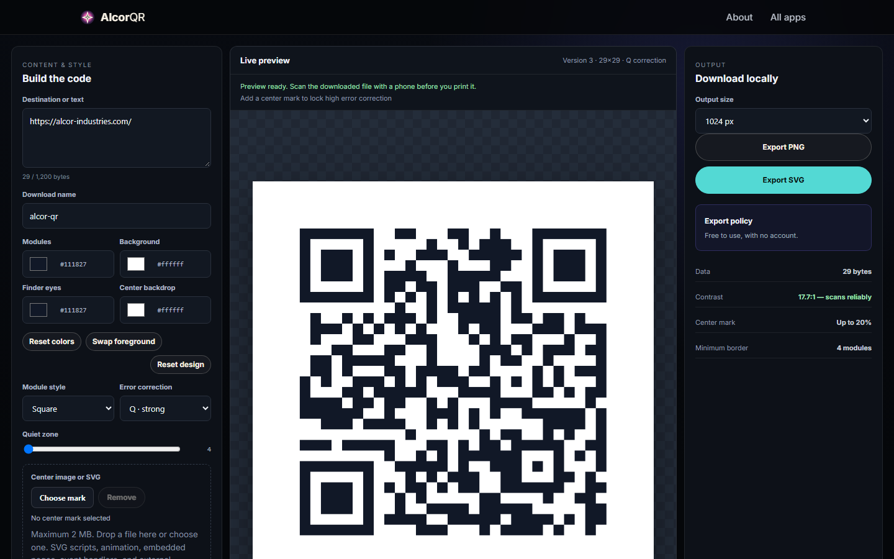

# AlcorQR

A QR code designer: colors, module styles, error-correction level, quiet zone (the blank margin)
and an optional center logo, exported as PNG (up to 4096 px) or SVG.

## Highlights

- **Designs that still scan.** `contrastRatio` and `validatePalette` compute the WCAG contrast
  between modules and background and warn before you export a code a phone can't read. The center
  logo is capped at the share of the code that error correction can recover.
- **Untrusted logos.** Uploaded SVG logos are checked and rejected if they contain scripts,
  animation, embedded pages, event handlers or external references.
- **Vector output.** SVG export builds the code from paths (`createSvg`, `svgModule`, `svgFinder`,
  `roundedRectPath`) with sanitized text and CSS, so it stays sharp at any print size.

## How it works

| File | Role |
|---|---|
| [`alcor-qr-core.js`](../assets/js/alcor-qr-core.js) | Validation and rendering rules: color contrast, options, matrix, export. No DOM. |
| [`alcor-qr.js`](../assets/js/alcor-qr.js) | The designer UI and live preview. |
| [`vendor/alcor-qr-engine.js`](../assets/js/vendor/alcor-qr-engine.js) | QR encoding (third party, MIT and Apache-2.0; see [`THIRD_PARTY_NOTICES.md`](../assets/js/vendor/THIRD_PARTY_NOTICES.md)). |

## Run it

Serve `AlcorApps/web` with any static server (see the [AlcorApps README](../../README.md)) and
open `AlcorQR/`.
