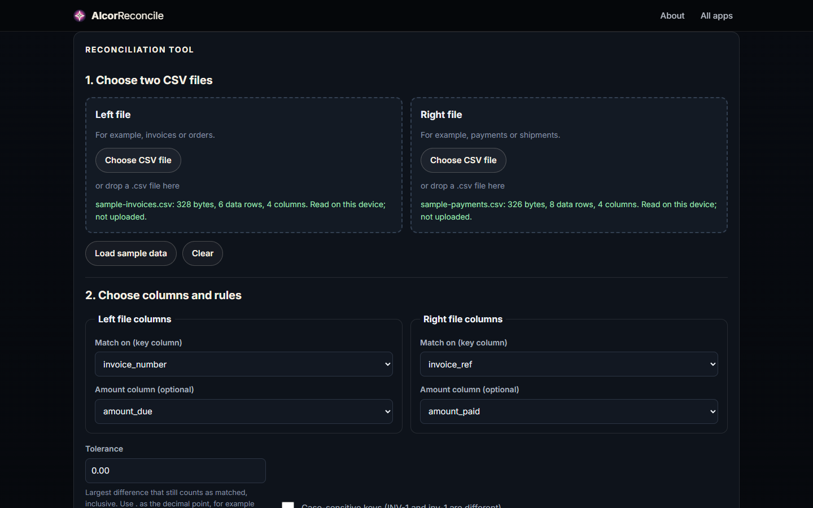

# AlcorReconcile

Compares two CSV exports, for example invoices against payments, and flags matches, amount
mismatches and records missing on either side. Results download as CSV. Files are read in the
browser and never uploaded.

## Highlights

- **Exact money math.** Amounts are parsed into integers with `BigInt` (`parseDecimal`),
  compared exactly, rounded with banker's rounding (`roundHalfEven`) and printed back with
  `decimalToString`. There are no floating-point rounding errors.
- **A strict CSV scanner.** `scanCsv` handles quoted fields, embedded newlines and escaped quotes
  and rejects malformed input instead of guessing.
- **Safe exports.** `csvField` neutralizes any value that starts with `=`, `+`, `-` or `@` (even
  after leading spaces or control characters) or with a tab or carriage return (`FORMULA_START`).
  A downloaded report therefore can't run a formula when opened in a spreadsheet (CSV injection).

## How it works

[`alcor-reconcile-core.js`](../assets/js/alcor-reconcile-core.js) is the engine (parsing,
matching, money math, export) with no DOM; [`alcor-reconcile.js`](../assets/js/alcor-reconcile.js)
is the UI.

## Run it

Serve `AlcorApps/web` with any static server (see the [AlcorApps README](../../README.md)), open
`AlcorReconcile/` and choose **Load sample data**.
