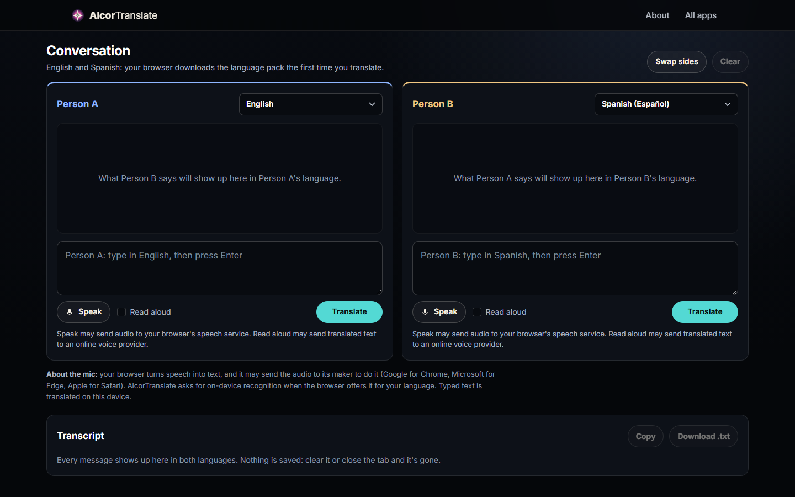

# AlcorTranslate

A two-person conversation translator: each person types or speaks in their own language and sees
the other side translated, with a transcript you can copy or download.

## Highlights

- **Two engines, one interface.** [`alcor-translate-app.js`](../assets/js/alcor-translate-app.js)
  picks the engine per language pair and normalizes language codes so both paths behave the same.
- **Verified models.** The worker checks every model file against the SHA-256 hash in
  [`models.json`](../assets/lib/bergamot-translator/models.json) before use and keeps it in Cache
  Storage, so a language downloads once.
- **Never blocking the page.** Translation runs in a worker; the UI stays responsive.

## How it works

1. Where the browser has a built-in translator (the `Translator` API in Chrome and Edge),
   AlcorTranslate uses it and translation happens on the device.
2. Everywhere else it runs Mozilla's Bergamot engine (compiled to WebAssembly) in a Web Worker
   ([`alcor-translate-worker.js`](../assets/js/alcor-translate-worker.js)), with the Firefox
   Translations models.
3. Speech input uses the browser's speech recognition, which may send audio to the browser
   vendor's service. The page says so next to the button.

## Run it

Serve `AlcorApps/web` with any static server (see the [AlcorApps README](../../README.md)) and
open `AlcorTranslate/`. The Chrome and Edge path works as is.

## Limitations

The Bergamot models are large and are not included, so the fallback path needs them added next to
the engine.

The Bergamot translator is MPL-2.0 licensed; see `LICENSE.txt` and `LICENSES.md` in
[`assets/lib/bergamot-translator`](../assets/lib/bergamot-translator).
