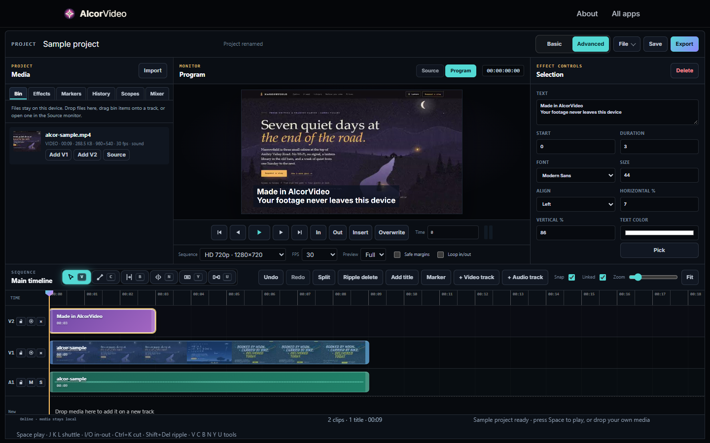

# AlcorVideo

A multi-track video editor in the browser: up to 12 video and 12 audio tracks, trimming and
splitting, keyframes, effects and transitions, colour grading, titles and captions, and export to
MP4 or WebM. Media never leaves the device.

## How it works

The editor is split into feature groups that load as separate bundles in this folder:

| Bundle | Contents |
|---|---|
| `editor-core.js` | Timeline model, editing operations, playback and the editor UI. |
| `editor-effects.js` | Effects and transitions, rendered per frame on a canvas. |
| `editor-grade.js` | Colour grading. |
| `editor-waveform.js` | Audio waveforms for the timeline. |
| `editor-export.js` | Export: frames drawn to a canvas, captured with `MediaRecorder`. |
| `editor-sample.js`, `editor-sample-webm.js` | The built-in sample project's media. |

On the live site these bundles are assembled on the server from the individual
`alcor-video-*.js` source files; here they are saved as static files so the app runs from a plain
folder.

## The hard parts

- **Rendering is the browser's own pipeline.** Each frame of the timeline is composited onto a
  canvas (layers, transforms, effects, grade, titles) and the canvas stream is recorded, so export
  needs no server and no native encoder. Codec support therefore depends on the browser.
- **Keeping a 24-track timeline responsive** while audio, video and canvas all share one page.

## Run

Serve `AlcorApps/web` with any static server, open `AlcorVideo/` and choose
**Try a sample project**.
