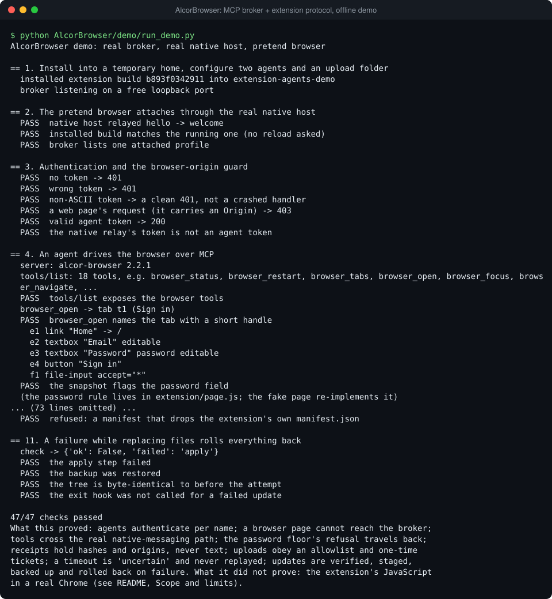
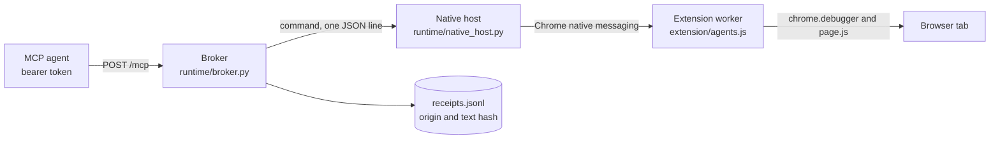
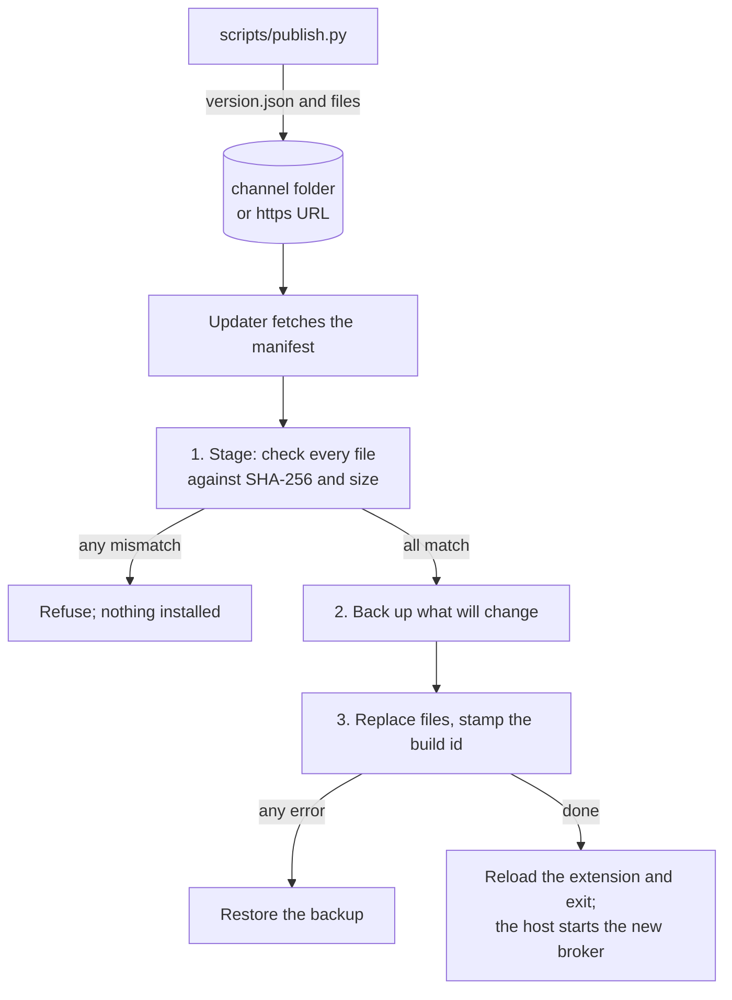

# AlcorBrowser: let AI agents drive your real browser over MCP, with receipts



Agents are most useful in a browser that is already signed in, but handing an agent your browser is
a trust problem: who is calling, what did they do, and what happens when a call half-works?
AlcorBrowser is a Chrome (Manifest V3) extension plus a small local Python broker. Agents call MCP
tools (open, snapshot, click, type, upload, a ChatGPT round trip, restart, update) with their own
bearer token, the broker turns each call into one command for the extension, and every call leaves
a receipt that keeps the page origin and a hash of any typed text, never the text itself.

## Why it's built this way

- **The real browser, through its own extension.** Clicks, keys and text go through `chrome.debugger`
  (`Input.*`), so pages see trusted events and signed-in sessions just work. If trusted input fails,
  a DOM fallback still acts and the result says `via: "dom"`. No remote-debugging port is opened.
- **The extension holds no secret.** It reaches the broker only through Chrome native messaging.
  Chrome starts the registered host only for the extension id in the host manifest, and that host
  reads the token from the broker's state folder. Agents have their own tokens, and the broker
  refuses any request that carries an `Origin` header, so a web page cannot call it.
- **Names live in the broker, actions in the worker.** The broker owns authentication and short tab
  handles (`t12`, scoped to a browser session); the worker runs one command on one tab and answers.
  A command is sent once: if no result arrives, the agent is told `uncertain: true` and the
  command is never replayed, because a repeated click is worse than an honest "unknown".
- **Receipts without content.** Each row has agent, tool, tab handle, page origin (no path),
  outcome, timing, and the length and a 16-character hash of the text the agent supplied. Page text
  and typed text are never written.
- **Two safety floors, scoped honestly.** The extension never types into a password field and never
  clicks into a CAPTCHA frame; the broker reports both as refusals. They guard a cooperative agent.
  They are not a sandbox: `browser_eval` runs arbitrary script in the page.
- **Updates are verified and reversible.** A manifest lists every file with its SHA-256 and size.
  The broker stages and checks all files before touching a live one, backs up what it will replace,
  and restores the backup on any error. The checks prove integrity, not authenticity.

## How it works



One tool call, end to end:

1. The agent posts a JSON-RPC `tools/call` to `/mcp` with `Authorization: Bearer <token>`. The
   broker compares the token in constant time, then checks the required arguments against
   `runtime/tool_specs.py` and drops any it does not know.
2. For a tab tool, the broker maps the handle (`t3`) to a Chrome tab id, takes that tab's lock, and
   writes `{"type":"command","id":...,"op":"type","args":{...}}` on the profile's stream.
3. The native host copies the line to Chrome as a native message. The worker runs `OPS[op]`: it
   injects `page.js` to read or locate elements, and sends trusted input through the debugger.
4. The worker replies `{"type":"result","id":...,"result":{...}}`. The broker wakes the waiting call,
   writes the receipt and answers the agent. No answer within the timeout means `uncertain`.

The stream between the host and the broker is `POST /v1/ext/attach`: the request body is the
worker's `hello` (profile label, browser session, version, build), and the response never ends.

| Direction        | Messages                                                                   |
| ---------------- | -------------------------------------------------------------------------- |
| worker to broker | `hello`, `result`, `event` (`tab-closed`), `hub` (a popup request), `ping` |
| broker to worker | `welcome` (`reload` when a newer build is on disk), `command`, `hub_reply` |

### The update channel



The source is a local folder or an `https://` base URL from `config.json`, with no default. The
build id is a hash of the extension's files, so any change to the extension makes a new build, and
the extension reloads itself when it finds a newer one on disk. Failed builds are retried by the
timer at most once an hour. Every step is a receipt (`update-start`, `update-staged`,
`update-applied`, `update-failed`, `update-restored`).

The manifest itself is validated before any file is fetched: the build id must be hex (it is
written into `config.js` and used in a folder name), every path must be exactly
`extension/<name>` or `runtime/<name>` with a plain name, and `extension/manifest.json` must be
listed, or the update would delete the extension's own manifest.

SHA-256 values come from the same channel as the files. They catch corruption, truncation and a
tampered file; they do not stop a malicious publisher, who can publish a matching manifest. Sign
`version.json` before relying on a channel you do not control.

### The safety floors

- **Password fields.** `browser_type` refuses a password field in the worker (`agents.js`), and the
  page-side `focus` and `domtype` refuse it again in case a script moved focus. `browser_press`
  refuses a character key while a password field has focus, so the rule cannot be bypassed one key
  at a time. Enter, Tab, arrows and Backspace still work, so a form can be submitted. Snapshots show
  `password` instead of the field's value.
- **CAPTCHA frames.** A click whose target is an iframe whose address or title looks like a CAPTCHA
  is refused, and the snapshot says `captcha frame present: hand it to the operator`.
- **Refusals are results, not silence.** The agent gets `refused: "password-field"` or `"captcha"`
  as an MCP error, and the receipt records it.

## Run it

There is nothing to install: the broker, host and demo use only the Python 3.10+ standard library,
and the extension has no dependencies or build step. The demo starts the real broker and native
host on a free loopback port inside a temporary folder, attaches a pretend browser, drives it as
two MCP agents, then publishes update channels, applies one, refuses a tampered one and rolls back
a failed one.

PowerShell, from the repository root:

```powershell
python AlcorBrowser\demo\run_demo.py
```

bash:

```sh
python3 AlcorBrowser/demo/run_demo.py
```

It prints `PASS` or `FAIL` per check and exits 0 only if all 47 pass (about ten seconds). A sample:

```text
== 4. An agent drives the browser over MCP
  tools/list: 18 tools, e.g. browser_status, browser_restart, browser_tabs, browser_open, ...
  browser_open -> tab t1 (Sign in)
    e2 textbox "Email" editable
    e3 textbox "Password" password editable
  (the password rule lives in extension/page.js; the fake page re-implements it)
  browser_type -> password field: {'ok': False, 'refused': 'password-field', ...}
  PASS  typing into the password box is refused and is an MCP error
== 9. Tamper with one published file: refused before anything is touched
  check -> {'ok': False, 'failed': 'verify'}
  PASS  nothing was installed: the tree is byte-identical
== 11. A failure while replacing files rolls everything back
  check -> {'ok': False, 'failed': 'apply'}
  PASS  the tree is byte-identical to before the attempt
```

What is real in the demo: the broker, MCP over HTTP, tokens, receipts, upload tickets, the native
host, the installer's file copy, the channel publisher and the update verifier. What is pretend: the
browser. `demo/fakes.py` plays Chrome and the extension worker against a tiny page model. It
re-implements the password rule so the refusal can travel through the real path; the rule itself
is in `extension/`, and the demo does not run that JavaScript.

Style checks: `ruff format --check AlcorBrowser`, `ruff check AlcorBrowser` and
`prettier --check AlcorBrowser`. There are no unit tests; the project verifies end to end, and the
demo is that check.

### Against a real Chrome (Windows)

1. `python AlcorBrowser\scripts\install.py install --label work` copies the files into
   `%LOCALAPPDATA%\AlcorBrowser` and prints the extension folder.
2. In Chrome open `chrome://extensions`, turn on **Developer mode**, choose **Load unpacked** and
   pick that folder. The extension's card now shows its **ID**: 32 letters, a to p. The id is not
   fixed in this repository; Chrome derives it from the folder you load, so each install has its own.
3. `python AlcorBrowser\scripts\install.py register-host --extension-id <that id>` registers the
   native-messaging host for that one extension and saves the id in `config.json`, which is where
   the broker reads it (`ALCOR_BROWSER_EXTENSION_ID` overrides it).
4. Reload the extension, then point an MCP client at `http://127.0.0.1:PORT/mcp` with a token from
   `state\agents\<name>.token`.

The full walkthrough (MCP client settings, the restart lane, updates, troubleshooting) is in
[docs/MANUAL.md](docs/MANUAL.md).

## Read the code

| File                                       | What to look at first                                                                                   |
| ------------------------------------------ | ------------------------------------------------------------------------------------------------------- |
| `runtime/broker.py`                        | `Broker.call_tool` to `_on_tab` to `BrowserConn.call` (the once-only command), `attach`, `upload_facts` |
| `runtime/tool_specs.py`                    | The 18 tools: names, argument schemas, read-only hints                                                  |
| `runtime/updater.py`                       | `Updater._apply`: stage, back up, replace, restore                                                      |
| `runtime/update_channel.py`                | `parse_manifest` (what a channel must look like) and `publish`                                          |
| `runtime/settings.py`                      | Everything an operator can configure, and how it is validated                                           |
| `runtime/companion.py`                     | `BrokerServer` (exclusive loopback bind) and `start`, which the native host relies on                   |
| `runtime/native_host.py`                   | The Chrome-stdio to attach-stream relay                                                                 |
| `runtime/alcorbrowser_restart.ps1`         | The Windows restart lane                                                                                |
| `extension/agents.js`                      | The `OPS` table, `cdp` and `cdpKey` (trusted input), `connectOnce`                                      |
| `extension/page.js`                        | `alcorPage`: snapshot, locate, and the floors inside the page                                           |
| `extension/popup.js`                       | The hub panel: status, update and restart                                                               |
| `scripts/install.py`, `scripts/publish.py` | Installing and registering the host; building a channel                                                 |
| `demo/run_demo.py`, `demo/fakes.py`        | The end-to-end story and the pretend browser                                                            |

## Scope and limits

- **The extension was not run in a real browser for this extraction.** It is the original code with
  names and comments changed, one safety fix (`browser_press` and password fields) and one diary
  line for errors reported by the native host. The demo replaces it with a page model, so the
  JavaScript is covered by formatting and review here, not by an automated test.
- **Anyone with an agent token controls every tab of the profile**, signed-in sessions included.
  The floors guard against accidents, not against a hostile agent; `browser_eval` can read or set
  anything on a page. Page text returned by `browser_snapshot` is data the agent sees, and
  "page text is not instructions" is a prompt-level rule, not something the broker enforces.
- **Local only.** The broker listens on loopback and refuses other addresses. There is no TLS and
  no remote access; tokens are files readable by your user.
- **Windows for real use.** The installer (registry) and the restart lane (Task Scheduler) are
  Windows-only. The broker, host and demo are plain Python and have been run on Windows only.
- **Update trust.** Integrity checks, not signatures (see above). A build that installs cleanly but
  misbehaves is not rolled back automatically; rollback covers install errors.
- **Uploads** are limited to the folders in `upload_dirs` (default: an `uploads` folder in the
  broker home), resolved before comparing, so `..` and links cannot climb out. The limit is 1 GiB,
  but the browser holds the whole file in memory while it uploads, so keep files small.
- **Cut from the private system:** a relay that let an agent gateway on another machine call the
  same tools (an SSH-forwarded long poll), named agent identities and their token files, a ChatGPT
  "lane" companion and reply gate from an older design, a grant and lease permission model the
  current design dropped, the publisher's push to a server, and a second, unverified update path in
  the restart script. The ChatGPT round trip (`browser_chatgpt`) stays; it depends on ChatGPT's
  page markup, which changes without notice, and the demo does not exercise it.

Extracted from the Alcor system; the remote relay, named agent identities, fixed extension id and
private update host were replaced by configuration (`config.json`, environment variables) and a
folder-based update channel.
