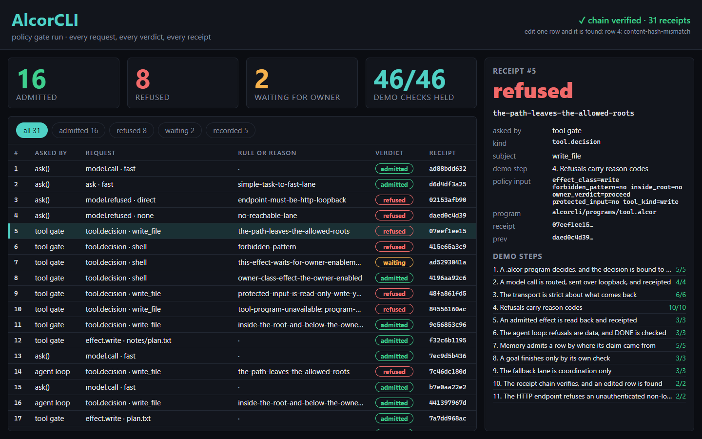
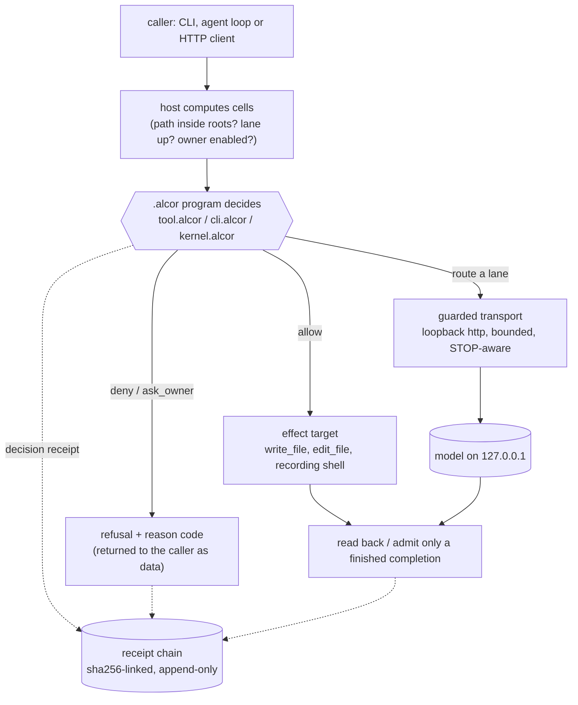
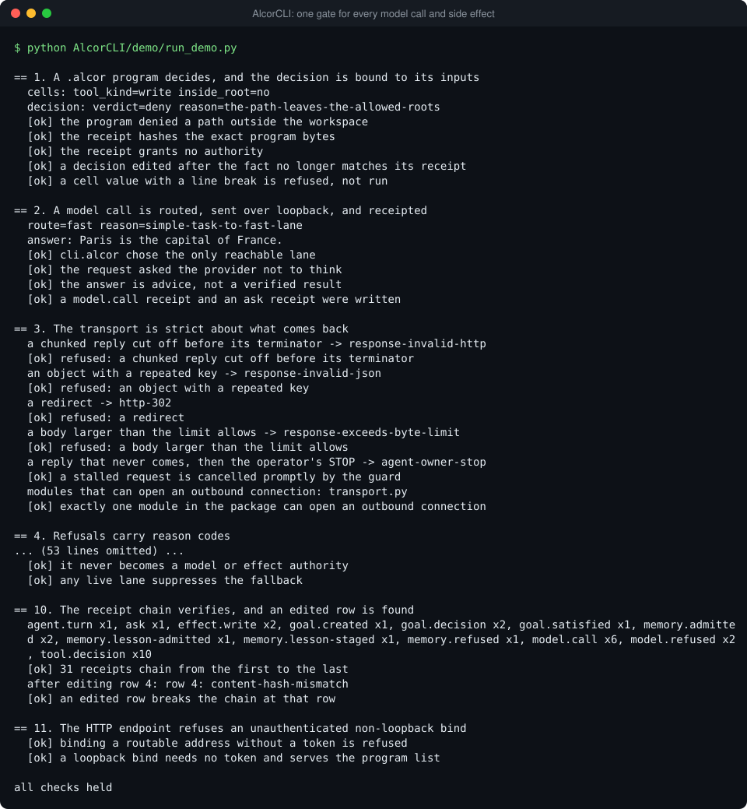

# AlcorCLI: the single gate between an agent and the world

AlcorCLI decides what an AI agent is allowed to do, and keeps tamper-evident proof of every decision.
Every model call and every side effect, such as writing a file, passes through it. Anything it cannot
confirm is safe, it refuses.



An agent that can call a model and change files needs one place where "may it?" is answered, and
where the answer leaves evidence. In AlcorCLI the host measures facts (is this path inside the
workspace, is this model endpoint up), a small `.alcor` program with no I/O decides, the host obeys,
and each step appends a **receipt**: a hashed record of what was asked, what was decided and why. The
system **fails closed**: a program that cannot answer is treated as "no", never as "yes".

## See it

Open `viewer/index.html` in a browser to explore a recorded demo run.

## Highlights

- **Policy is a program, facts are code.** Resolving a path or probing a port needs I/O, so the
  host does it and reports the result as a named cell (`inside_root=no`). What to do about it is
  a decision over a closed vocabulary, so it lives in a short `.alcor` file you can read in one
  sitting (`programs/tool.alcor` is 117 lines) instead of in a thicket of `if` statements. Policy
  can be audited without running the agent.
- **Unavailable is deny.** `PolicyHost.run` returns `decided`, `refused`, `unavailable` or
  `error`, and only `decided` is obeyed. A missing program, a runtime that raises, a cell with a
  line break, a receipt that does not verify, a decision that cannot be written to the receipt
  log: each one stops the call. Nothing falls back to "allow".
- **A decision is bound to what produced it.** The receipt hashes the exact program bytes, the
  exact cell values and the exact decision. Consumers recompute all three before obeying
  (`PolicyHost.verify`), so a program edited mid-turn, a doctored envelope or a replayed answer is
  caught. The receipt proves reproducibility, not that a caller's fact was true.
- **Loopback is enforced at one chokepoint.** `transport.guarded_http` refuses any URL that is not
  plain `http` to `127.0.0.1`, `localhost` or `::1` with an explicit port, refuses redirects, and
  then checks that the *resolved* addresses are loopback too. A remote model is reached through a
  tunnel, so the gate never speaks to a routable host. The HTTP endpoint (`serve.py`) applies the
  same rule inward: a non-loopback bind is refused unless a bearer token is configured.
- **Effects prove themselves, claims are checked.** A write reads itself back and returns the
  SHA-256 of the bytes on disk; a missing `content` is refused instead of truncating the file. When
  the model says DONE, the task's own check runs, and a claim about a file it never read back is
  pushed back once. The agent cannot grant itself owner permission (`owner_enabled`): only the
  operator's flag sets it.
- **Receipts carry hashes and counts, never text.** Every gate writes to one append-only log whose
  rows name the id of the row before. Edit or delete a row and `receipts verify` names the first
  one that fails.

## How it works



A **lane** is a named model endpoint (`fast`, `flash` or `deep`).

**A model call** (`ask.py`). Probe each lane over loopback, ask `cli.alcor` for a route, send the
request through the guarded transport, admit the reply only if the provider says it finished with
one choice and the expected model, then append a `model.call` receipt and an `ask` receipt. A
refusal (`no-reachable-lane`, `endpoint-must-be-http-loopback`) is a result with a receipt.

**An effect** (`tools.py`). `tool_cells` turns a call into cells, `tool.alcor` answers `allow`,
`deny` or `ask_owner` with a reason code, and only then does the handler run. Every decision is
receipted before the effect; if that receipt cannot be written the call is denied.

**An agent turn** (`agent.py`). One model call per round, then the tool calls it asked for, each
through the effect gate. At the end of every round `kernel.alcor` decides: continue, finalize,
push back, accept or fail. The ledger keeps everything; the model sees a bounded projection.

`ledger.py` (append-only threads, two-step commit of the final answer), `memory.py` (rows admitted
by where the claim came from; lessons staged until the operator admits them), `goal.py` (a goal
ends only when its own check exits zero) and `fallback_lane.py` (what is allowed when every lane
is down) follow the same pattern: host facts in, program decision out, receipt kept.

### The six policy programs

Every path through every program emits `effect_authority=false` (the program itself can never act),
and `PolicyHost.verify` rejects any decision that says otherwise. The language has no comment
syntax, so each program is documented by the module that hosts it.

| Program | Decides | Hosted by |
|---|---|---|
| `tool.alcor` | `allow`, `deny` or `ask_owner` for one tool call, with a reason code | `tools.py` |
| `cli.alcor` | Which lane answers; whether memory may be used; whether a lesson may be staged or admitted | `routing.py`, `ask.py`, `memory.py` |
| `kernel.alcor` | How a round ends: continue, finalize, push back, accept, fail | `agent.py` |
| `memory.alcor` | The admission of a remembered row: stamped, testimony, unsourced, refused | `memory.py` |
| `goal.alcor` | The next move for a goal: pursue, decompose, change approach, escalate, satisfied, halt | `goal.py` |
| `fallback_lane.alcor` | What the fallback may do when every lane is down | `fallback_lane.py` |

## Run it

Python 3.10 or newer, standard library only. The `.alcor` programs run on the sibling
[AlcorLang](../AlcorLang) package, so run everything from the repository root, where
`import alcorlang` resolves. No model and no network are needed.

```bash
python AlcorCLI/demo/run_demo.py           # end to end, prints what each step proves
python -m alcorcli doctor                  # what is configured and what works
```

The demo runs eleven sections, from a single policy decision to a tampered receipt chain, and each
ends in checks that print `ok` or `FAIL`. It exits non-zero if any check fails.



Try the CLI against a scripted model provider that listens on loopback (two terminals):

```bash
python -m alcorcli fake-provider --model demo-model --reply "Hello from the fake provider"
# prints http://127.0.0.1:<port>; leave it running

python -m alcorcli --lane-base fast=http://127.0.0.1:<port> ask "Say hello"
python -m alcorcli ask --endpoint http://model.example.com:80 "hi"      # refused: not loopback
python -m alcorcli tool call write_file --owner-enabled \
    --args '{"path": "notes/a.txt", "content": "hi"}'                  # allowed, read back, receipted
python -m alcorcli tool call write_file --owner-enabled \
    --args '{"path": "../x.txt", "content": "hi"}'                     # denied: path leaves the roots
python -m alcorcli receipts verify
```

Windows PowerShell 5 mangles quotes inside a JSON argument that contains spaces; put the JSON in a
file and pass `--args-file` instead. State lives under `$ALCOR_HOME` (default `~/.alcor`); effects
are confined to `--workspace` (default: the current directory). Lanes come from
`ALCOR_LANE_<FAST|FLASH|DEEP>_BASE` and `_MODEL` or from `--lane-base NAME=URL`; there is
deliberately no default address.

The fake provider is scripted text on a real loopback socket, so the real transport, the loopback
checks and the response admission all run. The demo's shell tool (`RecordingShell`) records a
command and never runs it.

## Tests

```bash
python -m pytest AlcorCLI/tests -q         # 163 tests; needs pytest
```

Start with `test_tool_program.py` and `test_claim_pushback_is_bounded.py`.

## Read the code

| File | What to look at first |
|---|---|
| `programs/tool.alcor` | The whole effect policy: 117 lines, one verdict per path through it |
| `policy.py` | `PolicyHost.run` (the four outcomes) and `verify` (recomputes every hash in a receipt) |
| `tools.py` | `tool_cells` (host facts), `admit_tool_call` (consult, receipt, fail closed), `ToolRegistry.invoke` |
| `transport.py` | `require_loopback_base`, `guarded_http` (deadline, STOP monitor, strict framing), `completion_message` |
| `ask.py`, `routing.py` | The model-call path and the lane probe; `programs/cli.alcor` holds the route policy |
| `agent.py`, `programs/kernel.alcor` | `_run_turn`, `_settle_claim` (a claim of DONE is checked), `_settle` (cells for the kernel) |
| `receipts.py` | The chain, `append` under a lock with fsync, and `verify` |
| `write_tools.py` | Read-back proof, byte-exact edits, refusal of an absent body |
| `memory.py`, `programs/memory.alcor` | Admission by provenance; lessons staged and admitted by the operator |
| `goal.py`, `programs/goal.alcor` | A goal with a checkable end; receipt verification before a verdict is used |
| `serve.py` | `Handler._guard`: loopback or a correct bearer token, never neither |
| `ledger.py`, `context.py` | Append-only thread, two-step commit, tool-transaction-safe compaction |
| `fakes.py` | The stand-ins: scripted loopback provider, in-memory shell |

## Limitations

- This is a policy gate, not a sandbox. There is no process isolation. Goal probe commands run as
  subprocesses with the operator's permissions, after passing the same effect gate.
- A path is checked and then used; a symlink swapped in between those two steps is not defended
  against.
- Plain `http` on loopback only. There is no TLS client, by design.
- An append to the receipt log re-reads the file to find the previous row. That suits an audit trail
  of thousands of rows, not millions.
- "Owner" means the human operator who runs the agent.
