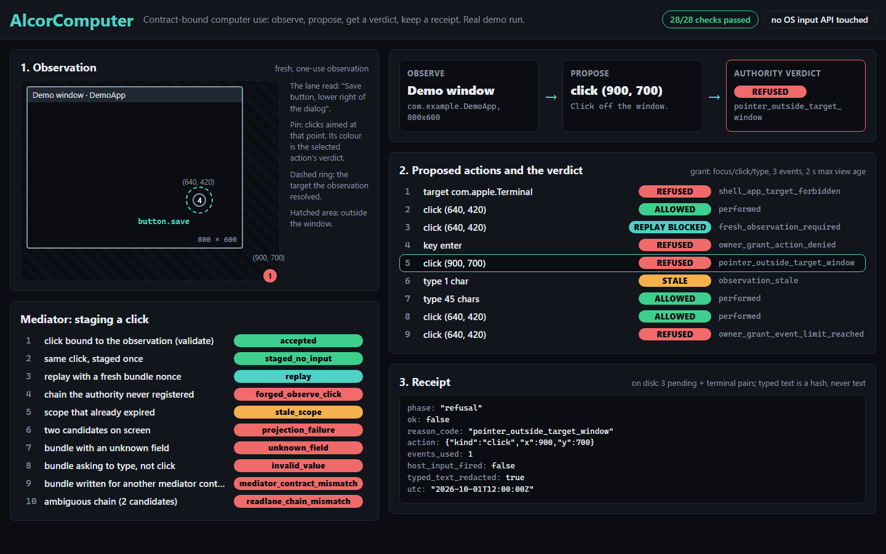
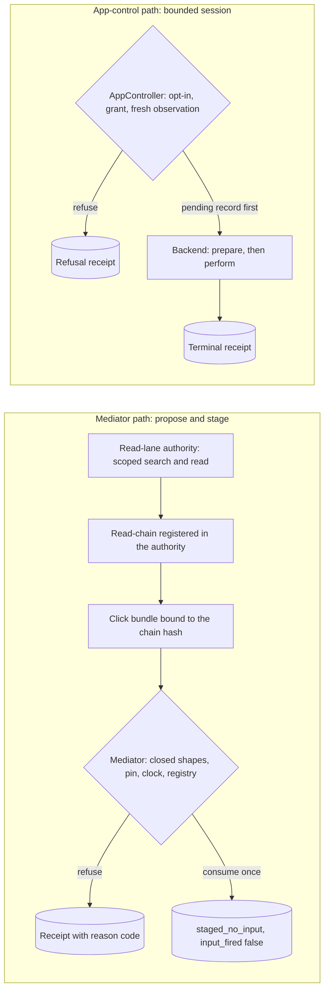
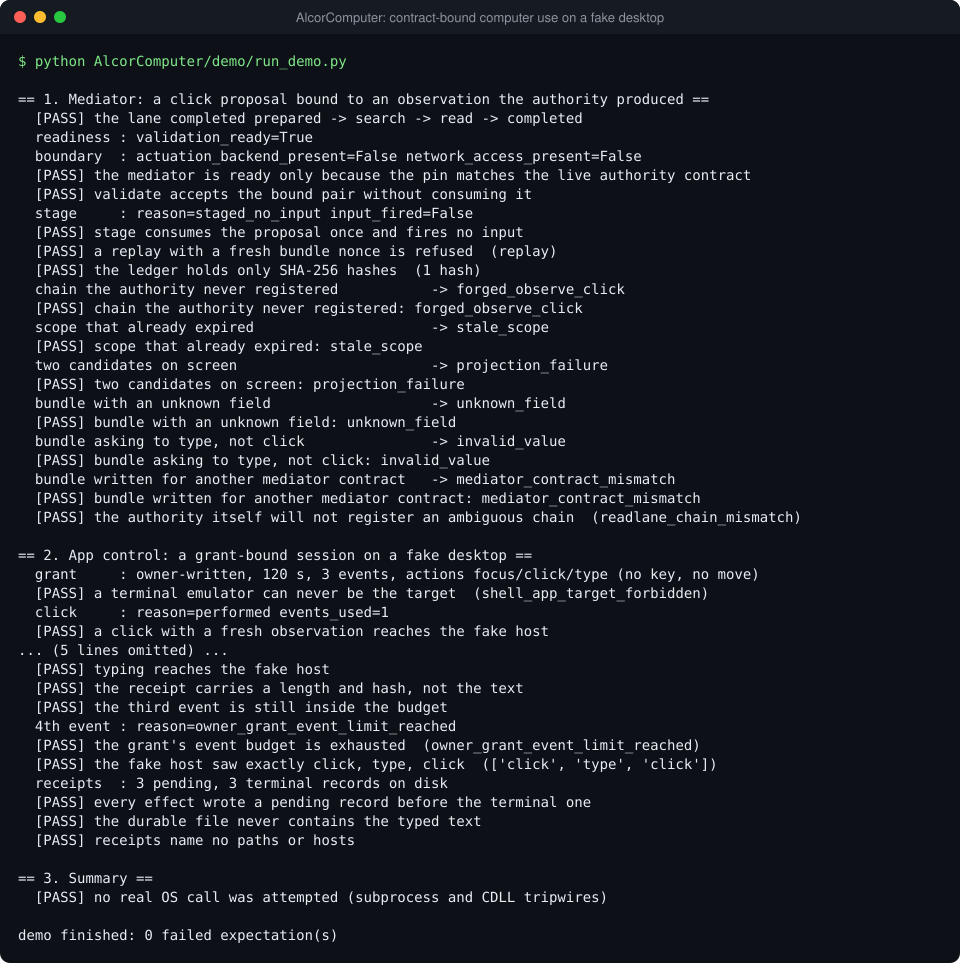

# AlcorComputer: contract-bound computer use with real macOS and Windows backends

AlcorComputer lets an AI model click and type on a real computer only when code can prove the action
is allowed. Every click must be tied to something the model really saw, it can be used once, and each
attempt leaves an audit record that contains no private content.



A model that can click and type on a real machine needs more than a permission prompt. This package
puts that power behind contracts that code checks. A **mediator** stages a click only if it is bound,
by hash, to an observation that a typed authority really produced. A bounded **app-control session**
lets input through only with a grant file the machine's owner wrote, a fresh one-use observation and
a second identity check, and it writes a durable **receipt** (a hashed record of the action) before
the event is sent. Two Python packages: `alcor_computer` (the mediator, its authority lane and
backends) and `alcor_click` (a small MCP plugin built on it; MCP is the Model Context Protocol, a
standard way for AI agents to call tools). Standard library only; the MCP servers need the optional
`mcp` package.

## See it

Open `viewer/index.html` in a browser to explore a recorded demo run.

## Highlights

- **The mediator proposes, it never acts.** It validates a click bundle and *stages* it: the proposal is
  consumed once and a sanitized receipt says `input_fired: false`. There is no actuator in the module, and
  `selftest` parses the package's top-level modules and fails if any imports an input or socket library.
- **Authority is a contract, not a flag.** The bundle must cite the exact hash of a read-chain, and the
  read-chain must have been registered by the read-lane authority in this process. A hash file or an
  environment variable cannot stand in for that, and a checked-in pin must equal the live authority
  contract hash or the mediator refuses everything.
- **Replay is keyed to the observation.** The ledger records the read-chain's hash, not the bundle nonce,
  so one observation cannot be reused with a freshly chosen nonce. It is a sorted file of SHA-256 lines
  that is rejected, not repaired, if it is empty, truncated or duplicated.
- **Four gates for real input.** The embedding program opts in; the owner's grant file (private, at most
  300 s, a bounded event budget, named actions) is re-read for every effect; the request cites the id of a
  fresh observation, which the effect consumes; and the backend verifies the target's identity once in
  `prepare_action` and again in `perform`.
- **Receipts are written first and carry no content.** A `pending` record is fsynced before the backend
  is called, the same file is the cross-process writer lease and event ledger, and an outcome that cannot
  be recorded holds the controller (`effect_outcome_ambiguous`). Typed text appears only as length and
  SHA-256, and every reason code comes from a fixed list.
- **A policy chooses, it does not command.** The reflex executor shows a fast policy only the legal
  actions of the current observation. Coordinates come from perception, text from the planner, and only an
  independent verifier can turn "I think I'm done" into a completed result.

## How it works



The paths are independent. A staged proposal is meant for a separate gated broker that performs the
input; `AppController` is the bounded session an embedding program uses to act on one application.

**The read-lane authority** (`alcor_computer/authority/`) issues a scoped read token, runs
`prepared -> search -> read -> completed` for a single-turn, data-only operator, and signs the finished
chain. Operator output must match a closed shape; asking for a wider scope, granting itself access,
declaring the step done or claiming a state change is each refused with its own reason code. Its tags are
HMAC-SHA256 values keyed from the *public* contract hash, so anyone holding the source can recompute them:
they are an **integrity check, not authentication**. Pass a random key to `ReadLaneAuthority(key)` when
other code in the deployment must not be able to mint tags. What keeps the operator out of the registry of
finished chains is that the registry is plain memory in the issuing process.

The three mediator classes share a name and stack: `mediator.ComputerUseMediator` (bounds every failure
into a receipt) extends `secure_mediator.ComputerUseMediator` (the pin gate, strict ledger and reason-code
allowlist), which extends `_mediator_core.ComputerUseMediator` (the contract itself).

## Run it

Python 3.10+. From the repository root:

```bash
python AlcorComputer/demo/run_demo.py
```

The demo needs no install and touches nothing real: a tripwire makes any `subprocess` or `ctypes.CDLL`
call raise, and the "desktop" is a few lines of Python behind the real macOS backend's test seams. It
stages a click, then refuses a replay, a chain the authority never registered, an expired scope, an
ambiguous projection (which the authority also refuses to register) and three malformed bundles. Then it
runs an app-control session where a replayed observation, a key outside the grant, an off-window click
and a stale observation are refused and the fourth event exceeds the budget. It prints reason codes and
exits non-zero if any expectation fails.



To serve the mediator over MCP, install the SDK (`pip install "mcp[cli]"`) and run
`python -m alcor_computer.mcp_server` from `AlcorComputer/` (`--check` lists the tools, `--config` prints a
client entry). Without the SDK it prints how to install it and exits with status 2. State goes to
`ALCOR_COMPUTER_STATE_DIR` (default `~/.alcor/computer`). Pillow is optional and only used for
screenshots in `alcor_click`.

## Tests

```bash
python -m pytest AlcorComputer                      # from the repository root
cd AlcorComputer
python -m alcor_computer.selftest
python -m alcor_computer.authority.static_check
```

98 tests, 28 of them for the authority; two POSIX-only tests skip on Windows. `selftest` fails if
any top-level module of the package imports an input or socket library. `static_check` parses the authority modules
without importing them and fails if any imports a network, process or input library, writes a file,
reads the environment or contains a URL.

## Read the code

| File | Look at first |
|---|---|
| `alcor_computer/_mediator_core.py` | `validate_pair` and `stage_json_pair`: the whole contract |
| `alcor_computer/secure_mediator.py` | `ReplayLedger`, `_load_binding` and `for_repo` |
| `alcor_computer/authority/issuer.py` | Scope issuing, result signing, the chain registry and the trust model |
| `alcor_computer/authority/lane.py` | `ReadLane.run`: the ordered chain in one function |
| `alcor_computer/app_control.py` | `AppController._effect` (every gate, in order) and `load_owner_grant` |
| `alcor_computer/backends/macos_app.py` | `prepare_action` then `perform`: the double identity check |
| `alcor_computer/backends/windows_win32.py` | The `ctypes` adapter: window identity, `SendInput`, GDI capture |
| `alcor_computer/backends/windows_private.py` | NTFS ACL privacy check for the grant and receipts |
| `alcor_computer/reflex_executor.py` | `legal_action_space`, `materialize_action` and `DesktopExecutor.run` |
| `alcor_click/control.py` | Observation-bound foreground-window input for Windows |
| `alcor_computer/mcp_server.py` | The three mediator tools and the optional-SDK failure path |
| `demo/run_demo.py` | All of it on a fake desktop |

## Limitations

- The real backends are not exercised against a live desktop by the tests or the demo. They are covered
  through their injection seams and by static checks; the macOS and Win32 calls themselves need a human
  at a machine, and the grant file must be written by hand (the controller never creates one).
- The authority's tags are not authentication (above). The finished-chain registry lives in memory and is
  lost when the process ends. The mediator's ledger is a local file, not shared storage.
- "Owner" means the person who owns the account and its files. On POSIX the grant must be a regular file
  with no group or world bits; on Windows its directory's ACL is checked instead.
- `WindowsAppBackend.elements()` needs an injected `element_provider` (for example a UI Automation
  adapter); none ships here.

## Credits

The reflex executor adapts design ideas from an MIT-licensed project; see [NOTICE.md](NOTICE.md).
