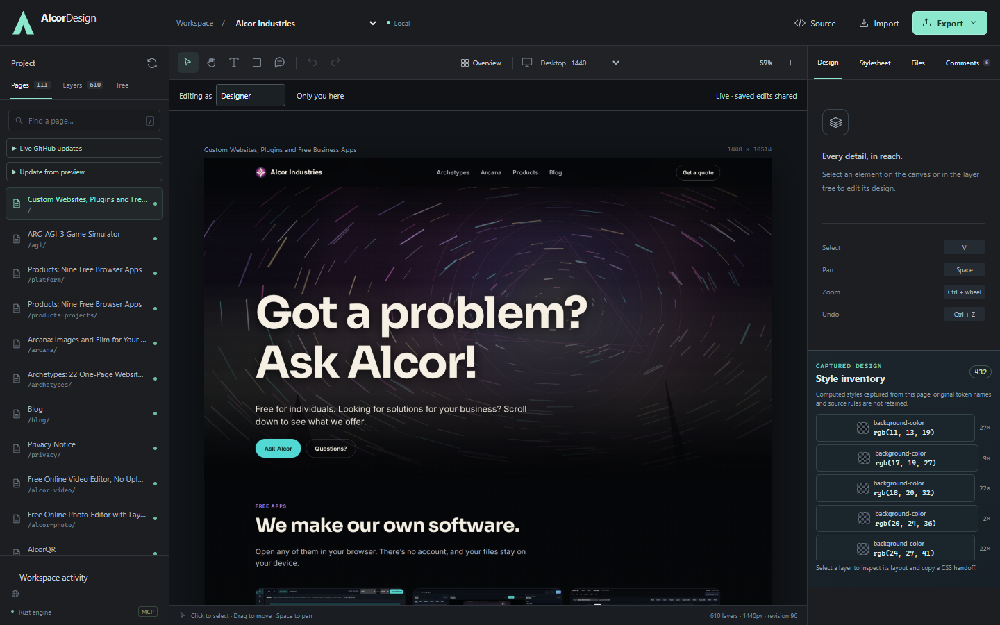
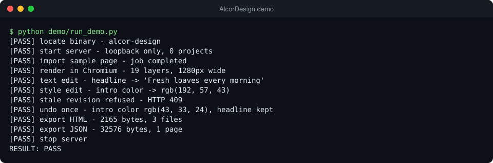

# AlcorDesign

AlcorDesign is a design editor for real, existing websites. Point it at a site and it renders
every page in Chrome and lays them out on a zoomable canvas, like Figma, where each element on the
page is a layer you can select and edit. You change text, styles and layout, leave comments, and
export the edited pages. It runs entirely on your own machine.



Under the hood, a Rust server owns the project store, editing rules and exports; a small Node
worker drives headless Chromium for layout; and every editor action is also available to AI agents
as an MCP tool (Model Context Protocol, the standard way to give an AI agent typed tools).

## Highlights

- **Edits can't silently overwrite each other.** Every page carries a `revision`, and every edit,
  insert, removal, re-render, undo and redo must send the `expected_revision` it read. A mismatch
  is refused with HTTP 409 and the client keeps the user's input. Nothing is merged silently.
- **The canvas is always the real browser's output.** Undo is a bounded stack (30 entries) of
  sanitized HTML snapshots, and undo re-renders the previous snapshot in Chromium, so the canvas,
  layer tree and export always come from the same rendered DOM. Layer IDs are stored as
  `data-alcor-design-id` attributes, so selections survive edits and undo.
- **Imported sites are treated as hostile.** The renderer follows only the site's own origin plus a
  few font and CDN hosts, refuses any host that resolves to a private address (including
  IPv4-mapped IPv6 and DNS answers that point inward), allows only GET and HEAD, and strips
  scripts, frames, event handlers and form values from snapshots.
- **A locked-down localhost API.** The server binds `127.0.0.1` only. Each run creates a random
  token; the UI gets it as an HttpOnly, SameSite=Strict cookie and agents read it from a local
  `runtime.json`. The Host header must match the bound port, which blocks DNS rebinding, and any
  Origin must be the app itself.
- **Crash-safe writes.** Project files are written to a temp file, fsynced and renamed. Effects
  that leave the machine (Git pushes, live refreshes) take a `request_id` and leave a durable
  receipt, so an uncertain outcome is reconciled instead of replayed.
- **One code path for every client.** The browser UI, the 42 MCP tools and the one-shot CLI all go
  through the same `App::tool` dispatcher and the same server state.

## What it does

- **Import** a site by URL (same-origin discovery from WordPress pages and posts, sitemaps and
  links, up to 500 pages), or paste raw HTML. Snapshot scripts never run.
- **Canvas** of full-page Chromium renders with nested layers, geometry and computed CSS, and
  responsive re-rendering at any width from 320 to 2,560 px.
- **Edit** text and styles, move layers, insert text or rectangles, delete layers, undo and redo.
- **Auto layout** controls for flexbox and grid: direction, wrapping, gaps, alignment, tracks, and
  per-child grow, shrink, basis, order and placement.
- **Comments** as pinned threads with replies, resolve and reopen.
- **Collaboration** between browser tabs on the same server: shared saved edits and comments,
  presence, cursors and selections. See [docs/COLLABORATION.md](docs/COLLABORATION.md).
- **Design index**: searchable page and layer tree sized for an agent's context. See
  [docs/DESIGN_INDEX.md](docs/DESIGN_INDEX.md).
- **Live refresh** from the live site without losing comments, with archived snapshots you can
  restore.
- **GitHub source view (optional)**: the CSS and PHP behind a page at the commit it was captured
  from, with CSS/PHP drafts pushed to a review branch. See
  [docs/GITHUB_UPDATES.md](docs/GITHUB_UPDATES.md).
- **Exports** as an HTML ZIP, JSON or CSS.

## How it works

| Module | Role |
| --- | --- |
| `src/main.rs` | Strict CLI parsing (`serve`, `mcp`, `call`, `copy-project`); binds the listener, then builds the app with the bound port. |
| `src/app.rs` | Application state, the `App::tool` dispatcher, page capture, imports, exports and the axum router with its `guard` middleware. |
| `src/collaboration.rs` | In-memory presence and the `RevisionConflict` error that becomes HTTP 409. |
| `src/live_refresh.rs` | Guarded recapture from the live site, durable operation receipts and the snapshot archive. |
| `src/design_index.rs` | Paged page and layer search, stylesheet mapping and source provenance. |
| `src/source_edit.rs` | CSS/PHP drafts and review-branch sync through a private bare Git cache. |
| `src/mcp.rs` | MCP stdio adapter and one-shot `call`; validates arguments against each tool's schema. |
| `src/config.rs`, `src/data_lock.rs`, `src/data_paths.rs`, `src/project_copy.rs` | Settings, single-server lock on the data directory, data directory discovery, offline project copy. |
| `renderer/worker.mjs` | One JSON request in, one JSON result out: discovery, capture, edits and HTML sanitizing in a fresh headless Chromium context. See [renderer/README.md](renderer/README.md). |
| `ui/` | Vanilla JS editor: canvas and layers, inspectors, auto layout, source tabs and presence. |

<details>
<summary>Code worth reading first</summary>

- `App::tool` and the `design_update_node` / `design_undo` arms in `src/app.rs`: the revision
  check, history push, re-render through `App::capture`, then `App::update_page`, which restores
  the in-memory page if the save fails.
- `guard` in `src/app.rs`: Host, Origin and token checks for every request, against the port the
  listener actually bound.
- `guardNetwork`, `verifiedUrl` and `privateAddress` in `renderer/worker.mjs`: the read-only import
  policy.
- `live_refresh::reserve`, `complete` and `finish` with `App::refresh_live_page`: a refresh can
  crash at any point and still be reconciled from its receipt; comments added during the capture
  are merged in.
- `SourceEdits::sync` and `run_git_command` in `src/source_edit.rs`: pushes from a bare cache with
  hooks disabled, never force-pushes, bounds Git's time and output, and refuses when the base and
  review branch changed the same file.
- `design_index::provenance`: which commit a page's source should be read at, and why.
- `project_copy::copy_project`: copies a project without overwriting anything and verifies hashes
  before the copy becomes visible.

</details>

## Run it

You need Rust 1.89 or newer, Node 18 or newer and Chrome or Chromium. Git is needed only for the
optional GitHub features.

```sh
cargo build --locked --release
cd renderer && npm install && cd ..        # installs Playwright for the renderer
./target/release/alcor-design serve
```

The server prints `AlcorDesign listening at http://127.0.0.1:<port>`; open that URL. On Windows
the renderer uses the installed Chrome; elsewhere it uses Playwright's Chromium
(`npx playwright install chromium`) unless `ALCORDESIGN_CHROME` names a browser. Import any public
site, or paste HTML into the import dialog.

<details>
<summary>Configuration</summary>

| Variable | Meaning |
| --- | --- |
| `ALCORDESIGN_PORT` | Listen port. Unset or `0` means a free port chosen by the OS. `serve --port N` overrides it. |
| `ALCORDESIGN_DATA_DIR` | Data directory for projects, captures, exports and `runtime.json`. Default: `%LOCALAPPDATA%\AlcorDesign`, else `$XDG_DATA_HOME/AlcorDesign` or `~/.local/share/AlcorDesign`. `serve --data PATH` overrides it. |
| `ALCORDESIGN_GITHUB_REPO` | `owner/repo` to turn on GitHub source browsing. Requires `serve --repo PATH` (a checkout whose `origin` is that repository). `serve --github owner/repo` does the same. |
| `ALCORDESIGN_GITHUB_BASE` | Branch that review branches start from. Default `main`. |
| `ALCORDESIGN_SOURCE_ROOT` | Repository folder that holds the deployed web root, for example `site`. Default: the repository root. |
| `ALCORDESIGN_SITE` | Deployed site used by GitHub imports that do not name `base_url`. |
| `ALCORDESIGN_PLAYWRIGHT` | Path to a Playwright `index.mjs`, if it is not installed in `renderer/`. |
| `ALCORDESIGN_CHROME` | Chrome or Chromium executable for rendering. |
| `ALCORDESIGN_NODE`, `ALCORDESIGN_APP_DIR` | Node executable, and the folder holding `ui/` and `renderer/` when the binary is moved. |

Without `ALCORDESIGN_GITHUB_REPO` the source tabs say they are not configured, and everything else
works.

</details>

**Connect an AI agent.** With the server running, point an MCP client at the same binary:

```json
{ "mcpServers": { "alcor-design": { "command": "/absolute/path/to/alcor-design", "args": ["mcp"] } } }
```

For a single call: `alcor-design call design_status '{}'`. [docs/MCP.md](docs/MCP.md) lists the
tools and the rules agents follow.

## Tests and demo

`python demo/run_demo.py` starts a server on a free loopback port with a throwaway data directory,
imports the bundled fictional page in `demo/sample/index.html`, renders it, applies a text edit and
a style edit, checks that a stale revision is refused, undoes once, exports HTML and JSON, and
stops the server. It needs no network. If no browser can start, the render, edit and undo steps
print SKIP.



Results on Linux (aarch64) with Node 22 and Chrome:

| Check | Result |
| --- | --- |
| `cargo test --locked` | 45 passed, 0 failed |
| `node --test ui/editor.test.mjs ui/inspectors.test.mjs renderer/*.test.mjs` | 11 passed, 0 failed (real Chromium) |
| `ui/native-*.test.mjs` against a fresh server (`ALCORDESIGN_URL`) | Editor and comments checks pass; the GitHub source check and the imported-site inspection skip without a repository or site project |
| `python demo/run_demo.py` | Every step PASS |
| Acceptance scripts in `tests/` | CLI safety, MCP adapter, data-directory lock, runtime discovery, project copy, collaboration, mobile workspace and six UI integrations pass. `collaboration_edges_acceptance.mjs` fails: the app bar intercepts a click on **Reset fields** at the default 1280×720 viewport. |

Each file in `tests/` says in its header how to run it.

## Limitations

AlcorDesign edits the rendered DOM of existing pages. It is not a replacement for Figma.

- No vector pen tool, components or variants, prototyping, or design tokens.
- Collaboration shares saved states between tabs on one server. There is no character-level
  co-editing, per-author undo, accounts or permissions.
- Canvas edits stay in the design; they are not rewritten into PHP or CSS source. Source drafts
  are edited separately and pushed to a review branch, never deployed.
- Snapshots disable JavaScript, so dynamic widgets render as they looked when captured. Exported
  assets keep their original absolute URLs and need the source site to load.
- Captures are bounded: 500 pages per discovery, 24,000 px of height and 2,000 visible layers per
  page by default.
- Data files rely on the data directory's OS permissions; keep it private to your user.

[docs/OPEN_SOURCE_DESIGN.md](docs/OPEN_SOURCE_DESIGN.md) compares AlcorDesign with Penpot and
OpenPencil.
