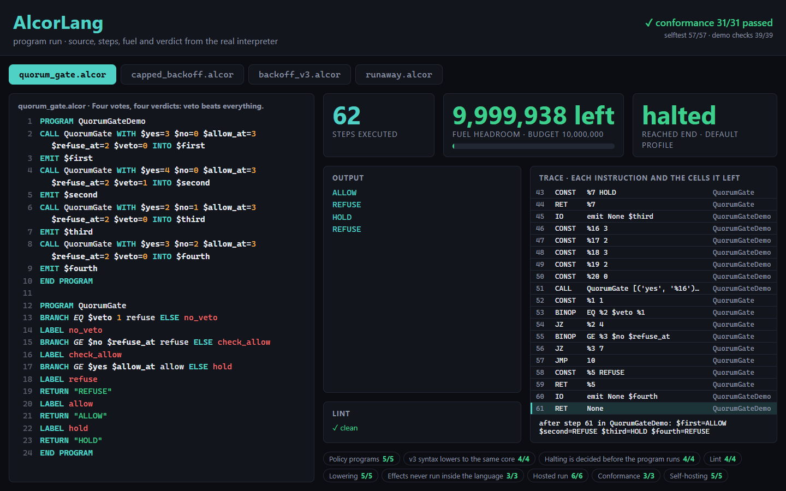
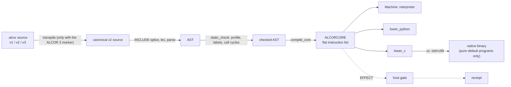
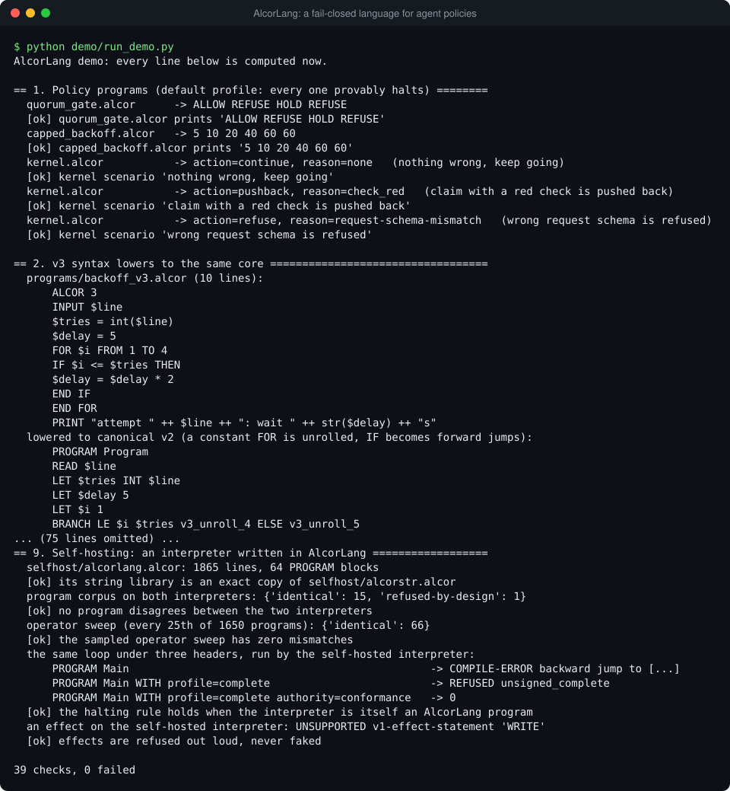

# AlcorLang: a small, fail-closed language for agent policies

AlcorLang (`.alcor`) is a programming language for the small decision programs an AI agent system has
to trust, such as "should this round continue, push back, or stop?". By default every program is
guaranteed to finish, and the language can never take an action on its own.



A program reads a request off an input tape and prints a decision. The default profile can only
describe a finite DAG (a flow chart with no way back), so every such program halts; loops and
recursion exist, but only behind explicit authority and a fuel budget. An effect, such as writing a
file, becomes one instruction that a host-supplied gate answers, and every attempt leaves a
**receipt** (a hashed record of the attempt and its outcome). Everything **fails closed**: any doubt
means refuse.

This folder is the whole language: a parser and checker, an interpreter, Python and C code
generators, a linter with stable rule ids, a conformance corpus with an independent judge, a
structured v3 syntax, and an interpreter for the language written in the language itself.
Standard library only; Python 3.10 or newer.

## See it

Open `viewer/index.html` in a browser to explore a recorded demo run.

## The language in ten lines

```
ALCOR 3
INPUT $line
$tries = int($line)
$delay = 5
FOR $i FROM 1 TO 4
  IF $i <= $tries THEN
    $delay = $delay * 2
  END IF
END FOR
PRINT "attempt " ++ $line ++ ": wait " ++ str($delay) ++ "s"
```

```console
$ python -m alcorlang run programs/backoff_v3.alcor --input-text 3
attempt 3: wait 40s
```

That is the v3 syntax (`ALCOR 3` marker, infix expressions, `IF`/`FOR`). It lowers, source to
source, to the v2 core, where a constant `FOR` is unrolled and `IF` becomes forward jumps, so the
program stays inside the halting profile:

```console
$ python -m alcorlang transpile programs/backoff_v3.alcor
PROGRAM Program
READ $line
LET $tries INT $line
LET $delay 5
LET $i 1
BRANCH LE $i $tries v3_unroll_4 ELSE v3_unroll_5
LABEL v3_unroll_4
LET $delay MUL $delay 2
JUMP v3_unroll_6
...
```

The v2 core underneath is small: cells (`$name`), prefix expressions, labels and jumps, and
`PROGRAM` blocks that `CALL` one another. This is spec Appendix A, and it prints `14`:

```
PROGRAM Main
LET $n 7
CALL Double WITH $x=$n INTO $r
EMIT $r
END PROGRAM
PROGRAM Double
LET $y MUL $x 2
RETURN $y
END PROGRAM
```

The first block is the entry. `CALL` copies its arguments by value into the callee's fresh frame
and `RETURN` delivers one value into the caller's `INTO` cell. `MUL $x 2` is prefix notation, so
there is no precedence to learn. (v2 has no comment syntax; v3 does.)

The real programs the language was written for look like `programs/kernel.alcor`: 22 values in
(a request schema, flags about the round), one decision out (`action=pushback`,
`reason=check_red`), with `effect_authority=false` stamped on every answer.

## Highlights

- **Halting is a compile-time property.** The `default` profile rejects `LOOP`, backward jumps and
  call cycles before anything runs (`checks.py`), so a default program is a finite DAG. Turing
  completeness is real (a Minsky machine is in the corpus) but opt-in: the `complete` profile needs
  authority (`run()` refuses it without), and a `fuel` budget stops runaways.
- **Effects are answered by a host, never performed by the language.** Every embedded statement such
  as `WRITE Message "x" TO File out.txt` compiles to one `EFFECT` instruction. The hosted path
  persists `ATTEMPTED` before the gate is called, so an effect happens at most once, and an
  `ATTEMPTED` record left behind by a crash is reported `UNKNOWN` and never replayed.
- **One IR, three backends, held together by a judge.** Every source compiles once to ALCORCORE, a
  flat list of eleven instruction kinds (the intermediate representation, or IR). The interpreter,
  the Python generator and the C generator all walk it, so they cannot drift on control flow. A
  separate referee runs each corpus test in its own process, and it can say no: its self-test fails
  a deliberately broken stub.
- **Prefix expressions, total operators.** `BRANCH GT $x 3 big ELSE small` needs no precedence table
  or delimiter. Every operator is defined for every input; an ill-typed or out-of-range case has a
  named trap (`div_zero`, `type_mismatch`, ...) instead of undefined behavior.
- **v3 is a frontend, not a second runtime.** It rejects anything it cannot lower while keeping v2's
  invariants, and a source without the `ALCOR 3` marker is returned byte for byte, so older programs
  never change meaning.
- **Programs are data.** `$cell` interpolation into an effect is inert text and gate descriptors keep
  the raw placeholder, so a cell value can never forge what a receipt says was requested.

## How it works



`alcorlang.run` is the whole pipeline in one call. The pieces are public: `transpile`, `parse`,
`compile_core`, `run`, `run_metered`, `lower_python`, `lower_c`, and `run_hosted` for the
authority-verified path.

### The command line

| command | what it does |
|---|---|
| `run FILE [--input FILE \| --input-text TEXT] [--metered]` | execute and print the output tape |
| `check FILE` | parse, check and compile; one summary line, exit 1 on rejection |
| `lint FILE` / `audit DIR` | diagnostics with rule ids; `--format json`, `--strict`, `--disable RULE` |
| `lower FILE --target python\|c` | emit standalone Python or C |
| `transpile` / `ast` / `directives` | v3 to v2 source; the AST as JSON; `.alcor.*` payloads |
| `native inspect\|build\|run\|asm FILE` | C-compiler driver with a hash-checked cache |
| `conformance` / `selftest` | the referee over the corpus; the in-process checks |
| `host FILE` / `host --sweep` | run on the self-hosted interpreter and compare with the reference |
| `table` | the vocabulary in force |

The linter's rule ids (such as `profile/unbounded-fuel` and `effect/in-loop`) and their meanings
are in [`docs/ALCORLINT.md`](docs/ALCORLINT.md). Errors fail the exit status; warnings do only with
`--strict`.

```console
$ python -m alcorlang lint programs/runaway.alcor
programs/runaway.alcor:1:1: warning profile/conformance-authority: authority=conformance is sandbox-only ...
alcorlint: 0 error(s), 1 warning(s), 0 info
```

### The conformance corpus

`conformance/conformance_v2.json` is the ground truth (where the spec prose and the corpus disagree,
the corpus wins): 31 tests in four cumulative milestones. M1 is the parser (8 `parse` tests,
including the fail-closed ones), M2 the executor (18 `run` and 1 `gate` test: arithmetic, branching,
a Minsky machine, recursion, traps, refusal, Unicode `LEN`), M3 the Python lowering (2 tests,
executed under `python -I` and compared exactly) and M4 the C lowering (2 static tests).
`referee.py` judges any directory holding an importable `alcorlang`, one child process per test,
failing closed on a timeout, a crash or a missing function.

### Self-hosting

`selfhost/alcorlang.alcor` is an AlcorLang interpreter written in AlcorLang: 1,865 lines and 64
`PROGRAM` blocks, 27 of them a string library shared byte for byte with `selfhost/alcorstr.alcor`.

- On all 1,650 programs of an operator sweep (every operator over ten typed operands, traps
  included) its output is identical to the reference's: `python -m alcorlang host --sweep`.
- It runs the string library's own self-test with a result byte-identical to the reference's (169
  lines, ending `ALCORSTR PASS`), and it runs itself running a program (`two levels deep: 5`).
- The halting rule survives: the same loop is rejected under `default`, refused as
  `unsigned_complete`, and runs under `complete` with authority, as in the reference.
- It is not a bootstrap: the Python reference starts it, and it costs about 1,600 to 6,500 times
  the interpreter steps of the reference on the programs measured. It refuses embedded effects,
  `INCLUDE`, `fuel=N` and code generation, each with a stated reason.

The full results, the cost table and one documented transport edge case are in
[`docs/SELFHOST.md`](docs/SELFHOST.md).

## Run it

From this folder (`AlcorLang/`); the package is `alcorlang/alcorlang`, so `python -m alcorlang`
finds it here. The demo runs offline, prints what each section proves and exits non-zero if any of
its 39 checks fails.

```bash
python demo/run_demo.py
python -m alcorlang run programs/quorum_gate.alcor
python -m alcorlang lint programs/runaway.alcor --strict
python -m alcorlang conformance
```



`python -m alcorlang native ...` and the native step of the demo need a C compiler (`cc`, `clang`
or `gcc`) and are skipped, saying so, without one.

## Tests

```bash
python -m pytest tests -q
```

83 tests; `pytest` is the only dependency. On Windows 2 skip: the case-collision test needs a
case-sensitive filesystem and the symlink test needs symlinks.

## Read the code

| file | look at first |
|---|---|
| `alcorlang/syntax.py` | `Parser.parse_expr`: single-token lookahead is enough for prefix expressions |
| `alcorlang/checks.py` | `static_check`: where the halting guarantee is enforced |
| `alcorlang/core.py` | `_BlockCompiler.stmt`: how every construct becomes one of eleven instructions; `compile_core` and why only INCLUDE-free sources are cached |
| `alcorlang/values.py` | `binop`: the total semantics (floor division, divisor-signed modulo, code-point `LEN`) |
| `alcorlang/machine.py` | `Machine._loop`: the interpreter; `_hosted_effect`: ATTEMPTED before the gate, reconcile after |
| `alcorlang/receipts.py` | `effect_result`: invariants that make an impossible receipt unconstructable |
| `alcorlang/hosted.py` | `verify_run_binding`: exactly what a verifier is asked to approve |
| `alcorlang/context.py` | `ExecutionContext` and the `EffectLifecycle` interface with its in-memory double |
| `alcorlang/lowering/` | `python_backend.py` and `c_backend.py`, plus the two runtimes they prepend |
| `alcorlang/v3/` | `frontend.py` (`IF`/`FOR` lowering, bounded unrolling), `directives.py` (closed token set, no credentials) |
| `alcorlang/lint.py` | the `_*_warnings` rule functions |
| `alcorlang/referee.py` | child-process isolation and the self-test that proves it can fail |
| `alcorlang/selfhost.py` + `selfhost/` | `compare`: how "hosted" is defined and tested |
| `docs/` | the [v2](docs/ALCORLANG_SPEC_V2.md) and [v3](docs/ALCORLANG_SPEC_V3.md) specs, [`SELFHOST.md`](docs/SELFHOST.md), [`ALCORLINT.md`](docs/ALCORLINT.md) |
| `programs/`, `conformance/` | the [example corpus](programs/README.md) and the conformance corpus |

## Limitations

- **The host side is pluggable.** The gate, the authority verifier and the durable effect store
  belong to whatever embeds the language. This folder ships the interfaces (`EffectLifecycle`, the
  verifier and gate signatures) and an in-memory reference store, `InMemoryLifecycle`. The demo's
  verifier approves any challenge bound to its own capsule, which proves the binding logic, not a
  real signature scheme.
- **Native code is narrow on purpose.** `native build` refuses anything but a pure default-profile
  program; C `EFFECT` traps closed. Integers are `int64` with overflow traps there and unbounded in
  the interpreter, as the spec states.
- **Vocabulary.** v1 statements canonicalize through a table of named elements;
  `alcorlang/data/periodic_table.json` holds the 23 elements the corpus and examples use, and any
  other token fails closed.
- **No real effect adapter ships.** The conformance gate only refuses, the demo's hosted gate only
  returns a receipt, and the lowered Python and C have no effect authority at all. The v1
  task-language compiler and the `AlcorVM` bytecode idea in the spec are not implemented.
