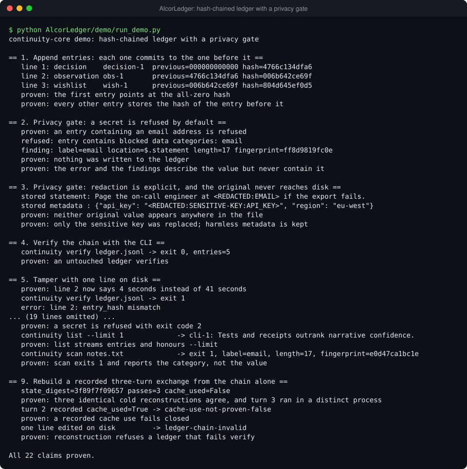
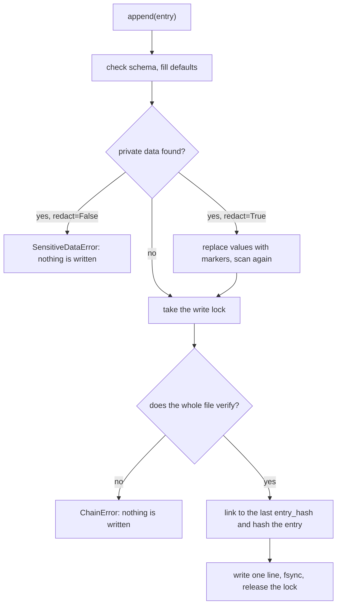

# AlcorLedger: a hash-chained, append-only ledger with a privacy gate

The Python package is `continuity-core` (import `continuity_core`, command `continuity`).



Long-lived agent memory and decision logs get copied, committed and published, and a secret that
lands in one is hard to take back. continuity-core stores each entry as one JSON line that carries
the SHA-256 of the line before it, and it scans every entry for private data before anything is
written: by default it refuses, and on request it replaces the value with a marker. `verify`
re-checks the chain, the schema and the privacy policy for the whole file, and an append refuses to
extend a file that fails.

## Why it's built this way

- **Refuse first, redact on request.** An entry is rejected if it contains an email address; a
  bearer, GitHub or `sk-` style token; a private-key header; a URL with embedded credentials; a
  home-directory path; an IPv4 or MAC address; or any value under a key such as `password`.
  Redaction is an explicit flag because silently rewriting a statement could hide a bad upstream
  data flow. Redacted entries are scanned again, and refused if anything detectable is left.
- **Findings never contain the value.** A finding carries the category, the location, the length
  and a 12-character fingerprint of the match. Error messages and logs stay safe to keep, and two
  findings can still be told apart.
- **Verify before every append.** `append` takes the write lock, verifies the whole file, links to
  the last hash, writes one line and calls `fsync`. A damaged ledger is never extended. The price is
  that each append re-reads the file, so cost grows with ledger size; large ledgers were not measured.
- **Canonical bytes.** Entries are stored as JSON with sorted keys and no extra whitespace, and the
  hash is taken over exactly that form. The hash then depends only on the data, so the demo prints the
  same hashes on every run.
- **One error per edit.** The next line is linked to the hash the previous line *claims*, not the one
  it should have. An edited line is reported once, on its own line, and a forger who recomputes that
  line's hash is caught on the following line instead.
- **Standard library only.** Writers are serialised by an in-process lock plus a lock file created
  with `O_EXCL`. There are no runtime dependencies.

## How it works



Each line has `id`, `kind` (`memory`, `observation`, `decision` or `wishlist`), a kind-specific
`status`, `statement`, `confidence`, `provenance`, `tags`, `supersedes`, `metadata`, `created_at`,
`expires_at`, and the three fields the ledger adds: `schema_version`, `previous_hash` and
`entry_hash`. `entry_hash` is the SHA-256 of the line's canonical JSON without `entry_hash` itself;
`previous_hash` is inside that JSON, so every entry commits to the whole chain before it. The first
entry points at 64 zeros.

`verify` checks every line for the exact field set, the link to the previous line, its own hash, a
unique id, the privacy policy and the schema, and keeps going so one run lists all the damage.
`reconstruct.py` is a worked example of using the chain as the source of truth: three tagged
entries record a three-turn exchange as hashes, and it rebuilds a state digest from the ledger
alone and checks the invariants (ordered turns, one thread, one terminal result per turn, no cache
use, turn 3 in a different process than turns 1 and 2).

## Run it

PowerShell, from the repository root:

```powershell
python AlcorLedger/demo/run_demo.py                  # chain, privacy gate, tampering, CLI, reconstruction
python -m pytest AlcorLedger                         # 29 tests, no install needed
python AlcorLedger/continuity.py verify AlcorLedger/examples/principles.jsonl   # no install needed

pip install -e AlcorLedger                           # optional: adds the `continuity` command
continuity init AlcorLedger/demo/state               # git-ignored scratch folder
continuity append AlcorLedger/demo/state/memory/public.jsonl --kind decision --statement "Receipts outrank narrative confidence."
continuity append AlcorLedger/demo/state/memory/public.jsonl --kind memory --statement "Mail alice@example.com"            # exit 2, refused
continuity append AlcorLedger/demo/state/memory/public.jsonl --kind memory --statement "Mail alice@example.com" --redact   # stored with a marker
continuity verify AlcorLedger/demo/state/memory/public.jsonl
```

bash, from the repository root:

```bash
python AlcorLedger/demo/run_demo.py
python -m pytest AlcorLedger
python AlcorLedger/continuity.py verify AlcorLedger/examples/principles.jsonl

pip install -e AlcorLedger
continuity init AlcorLedger/demo/state
continuity append AlcorLedger/demo/state/memory/public.jsonl --kind decision --statement "Receipts outrank narrative confidence."
continuity append AlcorLedger/demo/state/memory/public.jsonl --kind memory --statement "Mail alice@example.com"            # exit 2, refused
continuity append AlcorLedger/demo/state/memory/public.jsonl --kind memory --statement "Mail alice@example.com" --redact   # stored with a marker
continuity verify AlcorLedger/demo/state/memory/public.jsonl

# Tests without pytest:
PYTHONPATH=AlcorLedger/src python -m unittest discover -s AlcorLedger/tests
```

The demo needs no install or network and prints one `proven:` line per claim, ending with
`All 22 claims proven.`; it exits non-zero if any claim fails. `continuity scan <paths>` looks for
private data in files and exits 1 if it finds any. Exit codes are 0 for success, 1 for a failed
check and 2 for an error such as a refused entry.

## Read the code

| File | Look at first |
|---|---|
| `src/continuity_core/ledger.py` | `JsonlLedger.append` (lock, verify, link, fsync) and `JsonlLedger.verify` (the per-line checks); `_canonical_json` and `_entry_hash` define what is hashed |
| `src/continuity_core/redaction.py` | `_PATTERN_SPECS` (the detectors), `redact_text` (merges overlapping matches), `_blocked_key` (sensitive key names) |
| `src/continuity_core/cli.py` | `main` and the exit codes; the `init`, `append`, `list`, `verify` and `scan` verbs |
| `src/continuity_core/reconstruct.py` | `reconstruct`: the invariant checks, in order |
| `continuity.py` | The no-install launcher (puts `src` on the import path) |
| `examples/principles.jsonl` | A six-entry ledger that verifies |
| `tests/` | `test_ledger_hardening.py` (damaged ledgers are never extended), `test_continuity_three_turn.py` |
| `demo/run_demo.py` | The walk-through, including the tamper and forger cases |

## Scope and limits

- **Tamper-evident, not tamper-proof.** Editing, reordering or deleting a middle line is detected.
  Deleting the newest entries, or rewriting every line from an edit onward with fresh hashes, still
  verifies, because the chain has no secret key. Keep the newest `entry_hash` somewhere else to catch
  that; demo part 7 shows it. A valid chain proves the file is internally consistent, not that its
  statements are true or who wrote them.
- **The detectors are regular expressions.** They cover the shapes listed above and a fixed list of
  sensitive key names. They miss secrets in other forms, and they flag some harmless text, for example
  a four-part version number looks like an IPv4 address. They are a last line of defence, not a
  replacement for secret scanning at the hosting provider.
- **The lock is advisory.** If two waiters break the same stale lock (older than 120 s) at the same
  instant, both can write; `verify` reports the resulting broken chain and later appends refuse to
  extend it.
- **Local and single-file.** No encryption, signing or network. The tests and demo were run on
  Windows with Python 3.12; the code declares Python 3.10+ and has not been run on Linux or macOS here.
- **`reconstruct` checks recorded claims.** It shows the evidence is complete and consistent; it does
  not observe the processes the entries describe.
- **What was cut.** The original repository's own memory and wishlist ledgers (a six-entry sample is
  kept), its CI workflow and its design notes. Nothing is stubbed: the package has no private
  dependencies.

Extracted from the Alcor system; test fixtures now use reserved example addresses, and the launcher
test checks a bundled copy of the six-entry sample ledger.
