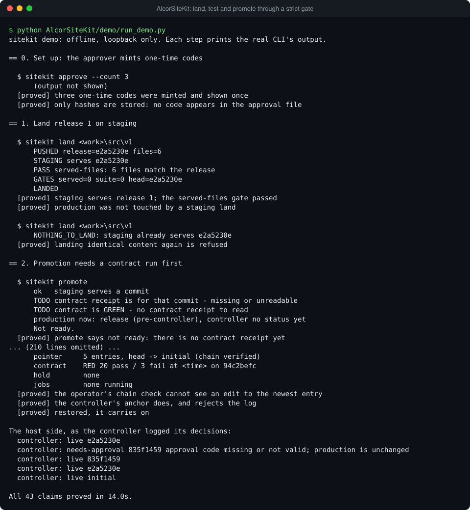
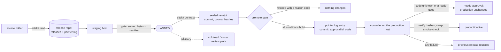
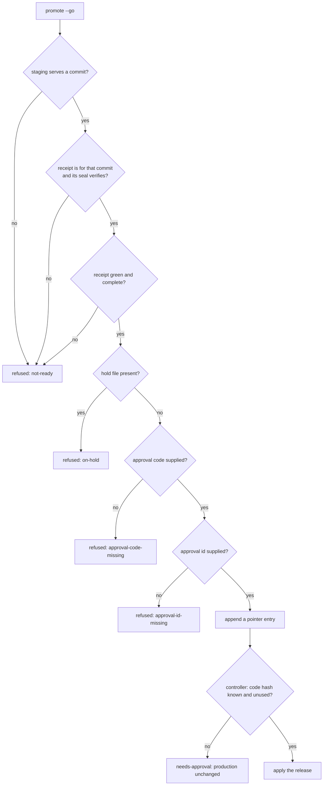

# AlcorSiteKit: a release tool that promotes a website to production only through a strict gate



Shipping a site change safely comes down to three questions: is what I tested the thing I am
shipping, did someone with authority approve this exact release, and can I undo it. AlcorSiteKit is
one command line that lands a change on staging, runs a contract of checks against it (plus optional
visual-baseline and model-read reviews), and moves production only when the promote gate and a
controller on the production host both agree. The gate compares commits and receipts; the controller
holds one-time approval codes as hashes, so the person running a release can present a code but
cannot mint one.

## Why it's built this way

- **The gate checks what is served, not what was intended.** `promote --go` compares the commit
  staging serves right now with the commit in the contract receipt, so a green run on older code
  cannot promote newer code. A receipt whose seal fails is ignored, and a run of only some suites
  (`--only`) is stored apart from the receipt the gate reads. `sitekit/gate.py` holds the six
  conditions in order; every refusal carries a stable reason code.
- **What is tested is what ships.** A release is a manifest of file hashes and its commit id is the
  hash of that manifest. Promotion names the id; the controller re-hashes every file before the
  swap, reads each back after it, and asks the site over HTTP whether the bytes are served as
  released. Any failure puts the previous release back.
- **Approval is enforced where the operator cannot skip it.** The CLI only requires that a code and
  an approval id were supplied. The controller checks the code against hashes it alone holds and
  burns it, even if the deploy then fails. A refused entry is never retried by waiting: a new
  `promote` is a new entry and a new attempt. Returning to a release that was live before needs no
  code, so an emergency undo is never blocked by an absent approver.
- **The audit trail is a log, not a variable.** `promote` and `rollback` are both appends to a
  hash-chained pointer log. The controller refuses a log whose chain breaks, and it remembers the
  last entry it acted on, which catches an edit to the newest line that the chain alone cannot see.
- **Advisory checks inform; they do not gate.** Cold read (do readers with no context understand
  what the site offers, who it is for and what to do next?) and the visual baseline produce a review
  pack. The model sits behind a two-method interface, and a reader gets one file in an empty folder
  because page text is untrusted data.
- **Foreground by default, background on request.** Every verb returns an exit code. `--detach`
  returns a job id for callers with short timeouts and keeps the approval code out of the job
  record. Nothing needs cron, `flock`, `nice` or bash, so it runs on Windows and POSIX.

## How it works



The gate is a pure function of the staging commit, the contract receipt, the hold file and the
supplied code and id. It stops at the first condition that fails:



Three roles use one command. They are separate on purpose, but the demo runs all three as one user.

| Role     | Who                                    | Verbs                                                                                     |
| -------- | -------------------------------------- | ----------------------------------------------------------------------------------------- |
| Operator | a person or an agent driving a release | `status` `land` `contract` `coldread` `visual` `review` `promote` `rollback` `jobs` `job` |
| Approver | whoever may approve releases           | `approve` (mints codes, shown once, stored as hashes)                                     |
| Host     | a process next to production           | `controller run --watch` (the part that decides and applies)                              |

A host is a folder with `public/` (the web root, swapped as one), `data/` (never touched) and
`.releases/` (bookkeeping). The web server in front of it must serve `public/`, serve
`.releases/status.json` at `/sitekit-status.json`, and send the commit from `.releases/current.json`
as the `X-Sitekit-Commit` header. `sitekit/mock_transport.py` is a loopback server that does this.

Two switches are plain files. A hold is `<home>/PROMOTE_HOLD`: while it exists `promote --go` is
refused, and its text is the reason. `<controller_dir>/STOP` pauses the controller.

## Run it

Python 3.10 or newer, standard library only. Node and Playwright are needed only for the optional
browser tools below.

```powershell
cd AlcorSiteKit
python demo/run_demo.py          # about 15 s; prints each CLI call and each claim it proves
python demo/run_demo.py --keep   # leave the temporary state for inspection
```

```sh
cd AlcorSiteKit
python3 demo/run_demo.py
```

The demo builds a small static site in a temporary folder, starts two directory hosts ("staging"
and "production") behind loopback web servers, starts the real controller as a second process, and
drives the real CLI through: land, contract, cold read, promote refused three ways (no code or id,
stale receipt, hold file), promote with a fresh code, the same code refused a second time, a
rollback without a code, a failing contract blocking promotion, the pre-controller site restored,
and a tampered audit log. It ends with `All 43 claims proved`, exits 1 at the first claim that does
not hold, and prints the same transcript on every run (ports, times and the temporary folder are
masked). It shows commands as `sitekit ...`; the real invocation is `python -m sitekit ...` from
this folder. An excerpt:

```text
  $ sitekit promote --go --approved APPR-0001 --code <code>
      ok   staging serves a commit
      ok   contract receipt is for that commit
      ok   contract is GREEN
      HOLD change freeze for the demo
      production now: release (pre-controller), controller no status yet
      refused [on-hold]: on hold: change freeze for the demo
  [proved] refused (on-hold) and the reason is shown
  [proved] the refused code was not consumed: 3 unused
```

There are no unit tests to run. The private repository's tests cover its stage pipeline and release
scripts, none of which is part of this extraction, and this repository verifies end to end only.
Lint and format: `ruff format --check AlcorSiteKit`, `ruff check AlcorSiteKit` and
`prettier --check AlcorSiteKit` from the repository root.

To drive it by hand, serve two hosts (each prints its URL), then point `.sitekit/config.json` at
them. State defaults to `./.sitekit`.

```sh
python -m sitekit.mock_transport .sitekit/hosts/staging --seed      # terminal 1
python -m sitekit.mock_transport .sitekit/hosts/production --seed   # terminal 2
```

```json
{
  "staging_url": "http://127.0.0.1:<port of terminal 1>",
  "production_url": "http://127.0.0.1:<port of terminal 2>",
  "intended_file": "../demo/intended.json"
}
```

```sh
python -m sitekit land demo/site
python -m sitekit contract
python -m sitekit approve --count 3                  # approver: copy a code, it is shown once
python -m sitekit controller run --watch             # host: its own terminal
python -m sitekit promote --go --approved APPR-0001 --code <code>
```

Settings come from the JSON file or `SITEKIT_<NAME>` environment variables (the variable wins):

| Setting                            | Default                            | Meaning                                                             |
| ---------------------------------- | ---------------------------------- | ------------------------------------------------------------------- |
| `SITEKIT_HOME` (env only)          | `./.sitekit`                       | state: receipts, jobs, baselines, captures                          |
| `staging_url`, `production_url`    | none                               | base URLs; commands that need one say which is missing              |
| `staging_dir`, `production_dir`    | `<home>/hosts/...`                 | host folders for the directory transport and the controller         |
| `repo_dir`, `controller_dir`       | `<home>/repo`, `<home>/controller` | release store and pointer log; approval hashes and controller state |
| `contract_file`                    | `contract.json` beside the package | the suites; each takes the base URL, prints `PASS`/`FAIL` lines     |
| `intended_file`                    | none                               | what the site should convey, for `coldread`                         |
| `smoke_pages`, `pages`, `unserved` | `["/"]`, crawl from `/`, none      | lists (comma-separated in the environment)                          |
| `transport`                        | `directory`                        | or `package.module:ClassName` for another way onto staging          |
| `poll_seconds`, `wait_seconds`     | `5`, `900`                         | how often and how long to wait for staging and the controller       |

Exit codes: 0 success; 1 refused or failed; 2 bad settings or arguments, or Node or Playwright
missing for the browser tools. `land` also returns 6 (staging never served the release), 7 (a
landing gate failed) and 8 (nothing to land).

**Visual baseline and browser capture (optional).** These use Playwright and are not run by the
demo. `npm install` installs the package only; then either `npx playwright install chromium` or
point `SITEKIT_CHROME` at an installed Chrome so no browser is downloaded. `SITEKIT_PLAYWRIGHT`
can name a Playwright installed elsewhere. Without Playwright the tools exit 2 with these
instructions and leave nothing behind.

```powershell
npm install
$env:SITEKIT_CHROME = "<path to chrome.exe>"
python -m sitekit visual --approve      # current screenshots become the baseline
python -m sitekit visual                # compare: FAIL only if a page is broken, INFO for edits
python -m sitekit coldread --capture browser --judge claude   # the keyword stand-in cannot read screenshots
```

**A real model for cold read.** `--judge keyword` is the offline stand-in. `--judge claude` runs the
`claude` command line once per read in an empty folder (it must be on `PATH`). For anything else,
write a class with two methods and name it:

```python
class MyModel:
    name = "my model"

    def read(self, persona, exposure, material):  # material: a Path to a .txt or an image
        ...  # return {"sells", "for_whom", "next", "confusing", "trust", "trust_why"}

    def judge(self, intended, page, view, exposure, answer):
        ...  # return {"offer": 0-2, "audience": 0-2, "next": 0-2, "note": "..."}
```

```sh
python -m sitekit coldread --judge mypackage.mymodule:MyModel
```

## Read the code

| File                                        | What to look at first                                                                           |
| ------------------------------------------- | ----------------------------------------------------------------------------------------------- |
| `sitekit/gate.py`                           | the promote gate: `readiness`, then `refusal`, in the order the diagram shows                   |
| `sitekit/controller.py`                     | `_decide`: pointer log, approval rule, apply, status; the host's whole policy                   |
| `sitekit/approvals.py`                      | one-time codes: minted once, hashed at rest, burned on use                                      |
| `sitekit/deploy.py`                         | `apply_release`: verify, swap, read back, smoke-check, restore; used for staging and production |
| `sitekit/repo.py`                           | release store and the hash-chained pointer log                                                  |
| `sitekit/release.py`                        | a release is a manifest; its commit id is the manifest's hash                                   |
| `sitekit/contract.py`                       | runs suites, counts `PASS`/`FAIL`, writes sealed receipts; complete versus partial runs         |
| `sitekit/receipts.py`                       | the seal: what it detects and what it does not                                                  |
| `sitekit/coldread.py`                       | the model interface, the keyword stand-in, the report and the review pack                       |
| `sitekit/cli.py`                            | the verbs; `cmd_promote` connects the gate to the controller                                    |
| `sitekit/mock_transport.py`                 | the offline host: a folder, a protected data file, a loopback server                            |
| `sitekit/transport.py`                      | the staging seam; implement `push` to deploy somewhere real                                     |
| `suites/site_checks.py`                     | a contract suite (structure and links); a template for your own                                 |
| `browser/visual.mjs`, `browser/capture.mjs` | the Playwright tools                                                                            |
| `demo/run_demo.py`                          | the walk-through; each `prove` names what it shows                                              |

## Scope and limits

**Replaced to run offline.** Hosts are folders behind a loopback server, not machines reached over
SSH and HTTPS. A commit id is a content hash instead of a git commit, the release repository is a
folder instead of a git remote, and the pointer log is a file instead of a branch. The cold-read
model in the demo is a keyword stand-in. It scores word overlap, understands nothing, and says so
in its report.

**Not carried over from the private system.** The git merge and manifest-repin steps of landing;
the site-specific end-to-end suites and release scripts; DNS and mail record checks; screenshot and
layout-probe helpers; the split of the host controller into a root process and a site-user process,
and its cron schedule (here one process with `--watch`). The private tool also has an emergency
fast path and the server a time-limited bypass; neither is included, so this gate has no bypass.
From the private stage pipeline only the sealed receipt and the idea of a closed set of refusal
reasons are used.

**Limits.**

- The demo runs operator, approver and host as one user, so their separation is a convention
  there. A deployment should make the approval hashes readable by the controller's user only.
- The approval code travels in the pointer log until the controller consumes it. Anyone who can
  read the log in that window can use the code, so keep the log's readers few.
- A seal detects an edit, not a forgery, and the hash chain is not a signature.
- The swap is two renames, so a request between them sees no site.
- File names in a release are limited to letters, digits and `_ . / -`; anything else is refused
  when the release is built, as are symlinks.
- A detached job that is killed leaves no `exit` file and keeps showing as running.
- Checked on Windows with Python 3.12, and with Playwright and an installed Chrome against the demo
  site (approve, compare, a colour change reported as INFO, a dark restyle failing every shot). The
  POSIX branches (`fcntl` locking, `start_new_session`) are written but were not run here. The
  `claude` model class was not run; only the stand-in and a test plug-in were.

**Fixed while porting** (each is a behaviour of the private version):

1. A partial `contract --only` run wrote the receipt the gate reads, so a green subset could
   promote. Only complete runs are read now, and the gate requires `complete`.
2. A contract with zero suites, or an `--only` typo that matched none, was green. Now it is red or
   an error.
3. A refused or failed release could not be retried: the attempt marker was keyed by commit.
   It is keyed by pointer entry, so a new `promote` gets a new attempt.
4. `rollback` chose "the previous release" from the pointer log, which is wrong after a refused
   promote. It uses the controller's published `live` and `previous`.
5. The pre-controller copy was recorded before the first release succeeded, so a failed first
   release left a record of an emptied folder and a later restore wiped the site. It is recorded
   after success and checked before use.
6. A code presented for a release that did not need one stayed valid while sitting in the log.
   Any presented code is spent now.
7. `sitekit job <id>` accepted any text as the id, so `..` could read a log outside the jobs
   folder. Ids are validated.
8. `promote` printed "To ship" while a hold file was in place. It now says it is on hold.
9. A contract run read the served commit only before the suites, so a staging change during the
   run went unnoticed. It is read again afterwards and a change makes the run red.

Extracted from the Alcor system; the private hosts, git remote, release scripts and decision-id
format were replaced by directory hosts, a local release repository and a plain approval id.
