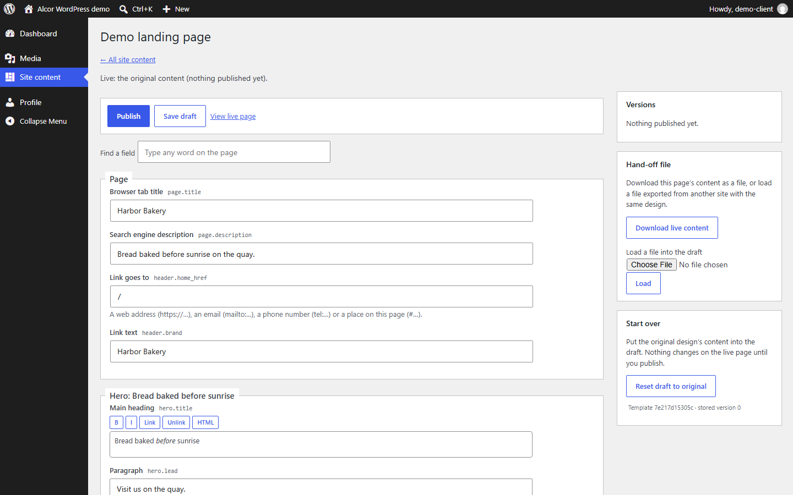
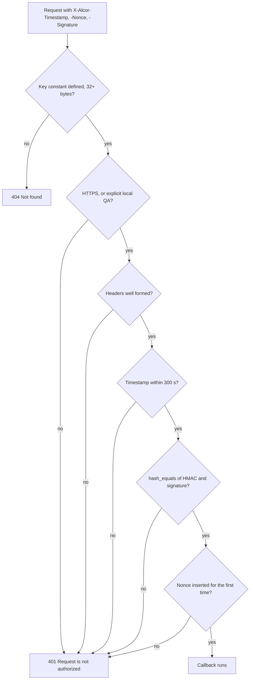
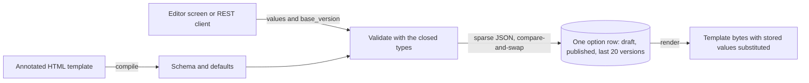

# AlcorWordPress

Ten WordPress plugins that run the Alcor Industries website: a content editor that lets clients
change words and images without breaking the page design, signed server-to-server API calls, and
security hardening for WordPress's default behavior. A one-command demo boots a real WordPress and
attacks the plugins over HTTP to show they hold.



The plugins are must-use plugins: PHP files WordPress loads automatically from
`wp-content/mu-plugins/`, which site administrators can't switch off. They cover:

- **AlcorFields**, a client-editable content model with a REST API.
- **HMAC authentication** (shared-secret request signing) for server-to-server calls.
- **Four hardening plugins** for CORS, user-name privacy, `security.txt` and preview sites.
- **The files search engines and AI agents read**: sitemap, FAQ structured data, IndexNow key,
  agent catalog and OpenAPI description.

Every plugin that guards something fails closed: when its configuration is missing or its input is
wrong, it refuses instead of guessing.


## Highlights

- **One permission function per route family.** WordPress treats a REST route without a
  `permission_callback` as public. AlcorFields registers seven routes; the six per-document routes
  share `Alcor_Fields_REST::can()`, so the rule can't drift between them. It checks from the
  cheapest question to the most specific (signed in? allowed to edit site content? does the
  document exist? is it assigned to you?) and answers 401, 403, 404, 403 in that order. An
  anonymous caller gets 401 for every document key, real or invented, so the routes can't be used
  to list which documents exist.
- **Constant-time signature checks.** Signatures are compared with `hash_equals()`. A plain `===`
  can stop at the first differing character, so response time would leak how much of a guessed
  signature was right.
- **Replay protection with a clock window and a nonce table.** The signed string includes a
  timestamp and a nonce (a single-use random value). The server refuses timestamps more than 300
  seconds from its own clock and records each accepted nonce with one atomic `INSERT IGNORE`, so
  two concurrent copies of a request can't both pass. The window keeps the table small: rows older
  than twice the window are deleted. The nonce is stored only after the signature verifies, so a
  caller without the key can't fill the table.
- **Failures say as little as possible.** With no key configured, a signed route answers 404, like
  a route that doesn't exist. Every other failure is the same 401 with the same body. Plain HTTP is
  refused unless an explicit constant, a `local` environment type and a loopback client all hold.
- **Closed field types and compare-and-swap writes.** AlcorFields has five value types and no
  "raw HTML" type, so no role, including administrator, can store markup the template didn't allow
  for. Each write carries the version that was edited and is a compare-and-swap on one database
  row, so two editors get a 409 conflict instead of a silent overwrite.
- **WordPress defaults replaced where they leak.** Core echoes any request `Origin` back with
  `Access-Control-Allow-Credentials: true`; `alcor-rest-cors.php` limits that to the site's own
  origin. Core reveals login names through `/?author=1`, `/wp/v2/users`, oEmbed and feeds;
  `alcor-no-user-enumeration.php` closes those.

## How it works

### Service-to-service authentication

A route opts in by calling `alcor_s2s_verify( $request, 'ALCOR_ORDERS_KEY' )` from its
`permission_callback`. The caller signs the method, route, sorted query, timestamp, nonce and body
hash with HMAC-SHA256. The exact format is in the header of
[`alcor-s2s-auth.php`](mu-plugins/alcor-s2s-auth.php), and
[`examples/sign_request.py`](examples/sign_request.py) is a client for it (standard library only).



### AlcorFields

A designer annotates an HTML page with `data-af-*` attributes. The annotations are the schema: a
field exists exactly where the page shows it, and its default is what the designer wrote. An editor,
or a REST client, changes words, links, images, list items and optional sections, never markup.



| Route (`alcor-fields/v1`)       | What it does                                      |
| ------------------------------- | ------------------------------------------------- |
| `GET /documents`                | The documents the caller may edit                 |
| `GET /documents/<key>`          | Schema, live and draft content, version           |
| `POST /documents/<key>/draft`   | Save a draft (live page unchanged)                |
| `POST /documents/<key>/publish` | Publish the given values, or the current draft    |
| `POST /documents/<key>/restore` | Copy a published version into the draft           |
| `GET /documents/<key>/export`   | The hand-off file, bound to its content by a hash |
| `POST /documents/<key>/import`  | Validate a hand-off file and store it as a draft  |

An export's content hash detects damage but is not a signature, so import validates every value
again, exactly like an editor's save. The wp-admin screens (`class-alcor-fields-admin.php`) follow
the same rules: a capability check and a nonce on every action, plain forms that work without
JavaScript, and a draft preview link that needs a login, permission for that document and a nonce.

### The other plugins

| Plugin                          | Job                                                                                            |
| ------------------------------- | ---------------------------------------------------------------------------------------------- |
| `alcor-rest-cors.php`           | Core's CORS headers only for the site's own origin; a late pass strips what other code adds    |
| `alcor-no-user-enumeration.php` | Author redirects, REST user lookups, oEmbed and feeds no longer expose account names           |
| `alcor-security-txt.php`        | RFC 9116 `security.txt`; not served at all if the configured contact is malformed              |
| `alcor-preview-noindex.php`     | Loopback and `staging.`/`deploy.` hosts get `noindex`, and canonical links point to production |
| `alcor-agents.php`              | `/agents.json` catalog, OpenAPI 3.1 at `/openapi.json`, robots.txt groups for AI crawlers      |
| `alcor-faq-schema.php`          | `[alcor_faq]` prints the questions and the matching `FAQPage` JSON-LD from one list            |
| `alcor-public-sitemap.php`      | Lists code-served routes in the core sitemap; unknown sitemaps are 404, not the homepage       |
| `alcor-indexnow.php`            | Serves the IndexNow key file from a constant or option, never from source                      |

## Run it

You need Node 20.18 or newer. The first start downloads the WordPress Playground CLI, WordPress and
a PHP runtime, so it needs network access and a few minutes; later starts reuse the cache.
[WordPress Playground](https://wordpress.github.io/wordpress-playground/) runs PHP as WebAssembly,
so give it free memory.

```sh
cd AlcorWordPress
node demo/run-demo.mjs
```

The script picks a free loopback port, generates passwords and keys for this run only, boots the
site, mounts the plugins and prints one line per check. It exits `0` only if every check passed
(`1` if a check failed, `2` if the site could not start) and writes a machine-readable copy to
`demo/out/results.json`. The pinned versions are at the top of
[`demo/lib/playground.mjs`](demo/lib/playground.mjs).

To sign a request by hand, put a random 32-byte key in an environment variable (never on the
command line):

```bash
export ALCOR_S2S_KEY="$(openssl rand -hex 32)"
python examples/sign_request.py --url "https://example.com/wp-json/acme/v1/status?region=eu"
```

```powershell
$bytes = New-Object byte[] 32
[Security.Cryptography.RandomNumberGenerator]::Create().GetBytes($bytes)
$env:ALCOR_S2S_KEY = ($bytes | ForEach-Object { $_.ToString('x2') }) -join ''
python examples/sign_request.py --url "https://example.com/wp-json/acme/v1/status?region=eu"
```

The signature covers the route `/acme/v1/status` and the query `region=eu`, not the host. The
headers it prints are single-use and expire after five minutes.

To use the plugins on a site, copy `mu-plugins/*` into `wp-content/mu-plugins/` and set what you
need in `wp-config.php`:

| Constant                                                   | Plugin       | Meaning                                                                            |
| ---------------------------------------------------------- | ------------ | ---------------------------------------------------------------------------------- |
| `ALCOR_<NAME>_KEY` (32+ bytes)                             | s2s-auth     | Shared secret of one route family; the route names it in `alcor_s2s_verify()`      |
| `ALCOR_S2S_LOCAL_QA`                                       | s2s-auth     | `true` allows plain HTTP, only with environment type `local` and a loopback client |
| `ALCOR_SECURITY_TXT_CONTACT`, `ALCOR_SECURITY_TXT_EXPIRES` | security-txt | Contact URI and expiry; placeholders are served until you set them                 |
| `ALCOR_INDEXNOW_KEY` (or the `alcor_indexnow_key` option)  | indexnow     | 8 to 128 letters, digits and dashes                                                |
| `ALCOR_AGENTS_CONTACT_EMAIL`                               | agents       | Address in the agent catalog and the OpenAPI document                              |

The agent catalog's services and the sitemap's routes are configurable through the
`alcor_agents_services`, `alcor_agents_quote_path`, `alcor_public_routes` and
`alcor_sitemap_noindex_paths` filters.

## Tests

The demo is the test suite: 41 end-to-end checks against a fresh WordPress, run over HTTP. They
cover refused anonymous calls, edit conflicts, hostile content and tampered imports, accepted
signed calls, refused replayed, stale and altered calls, private user names, CORS, `security.txt`,
preview `noindex`, the sitemap, the agent files and IndexNow. The
last run passed 41 of 41; its transcript is in [`demo/last-run.txt`](demo/last-run.txt).

## Read the code

| File                                                                                                                         | Look at first                                                                                |
| ---------------------------------------------------------------------------------------------------------------------------- | -------------------------------------------------------------------------------------------- |
| [`mu-plugins/alcor-s2s-auth.php`](mu-plugins/alcor-s2s-auth.php)                                                             | `alcor_s2s_verify()`: the order of the checks, and why the nonce is stored last              |
| [`mu-plugins/alcor-fields/src/class-alcor-fields-rest.php`](mu-plugins/alcor-fields/src/class-alcor-fields-rest.php)         | `can()`, the shared permission callback, and `guard()`, which maps failures to 409/422/500   |
| [`mu-plugins/alcor-fields/src/class-alcor-fields-store.php`](mu-plugins/alcor-fields/src/class-alcor-fields-store.php)       | `update()`: compare-and-swap on one row                                                      |
| [`mu-plugins/alcor-fields/src/class-alcor-fields-types.php`](mu-plugins/alcor-fields/src/class-alcor-fields-types.php)       | The five closed types; `inline()` rebuilds markup from a parse tree                          |
| [`mu-plugins/alcor-fields/src/class-alcor-fields-template.php`](mu-plugins/alcor-fields/src/class-alcor-fields-template.php) | `visit()` turns annotations into a schema; `repair()` keeps client content across a redesign |
| [`mu-plugins/alcor-fields/src/class-alcor-fields-html.php`](mu-plugins/alcor-fields/src/class-alcor-fields-html.php)         | The strict parser: it refuses ill-formed markup instead of repairing it                      |
| [`mu-plugins/alcor-rest-cors.php`](mu-plugins/alcor-rest-cors.php)                                                           | Origins compared as scheme, host and port; the late `PHP_INT_MAX` pass                       |
| [`demo/lib/checks.mjs`](demo/lib/checks.mjs)                                                                                 | The end-to-end checks, in the order a reader would try the attacks                           |
| [`demo/plugin/alcor-demo-fixtures/`](demo/plugin/alcor-demo-fixtures/)                                                       | Demo fixtures: a sample page template, two signed routes, a sitemap route                    |

## Limitations

- The demo doesn't drive a browser, so the wp-admin screens and `admin.js` are not covered. Nor
  are the `max_input_vars` fallback and concurrent requests.
- The demo's database is SQLite, translated from MySQL by Playground's driver. The nonce table's
  MySQL `INSERT IGNORE` becomes SQLite's `INSERT OR IGNORE` there.
- The agent catalog and OpenAPI file describe a quote endpoint but don't implement one; point
  `alcor_agents_quote_path` at the route your site already has.
- The demo needs the npm registry and WordPress downloads on its first start. Neither WordPress nor
  the Playground CLI is part of this folder.
