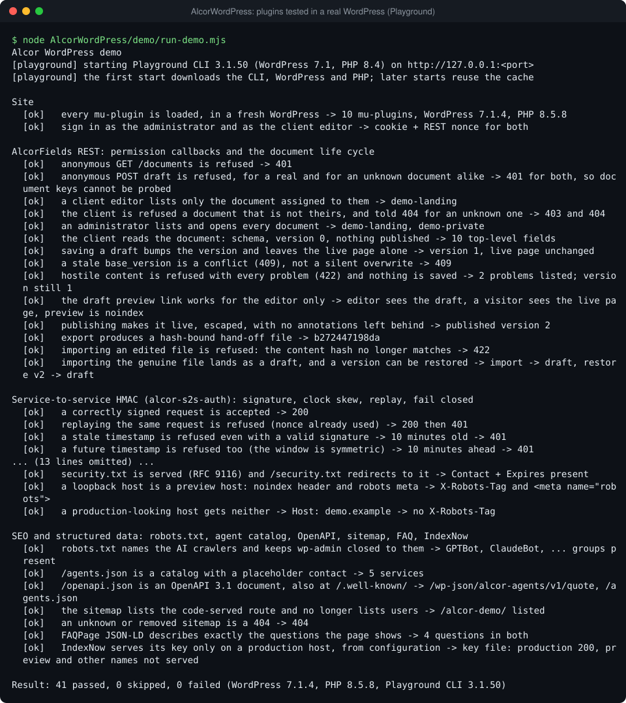
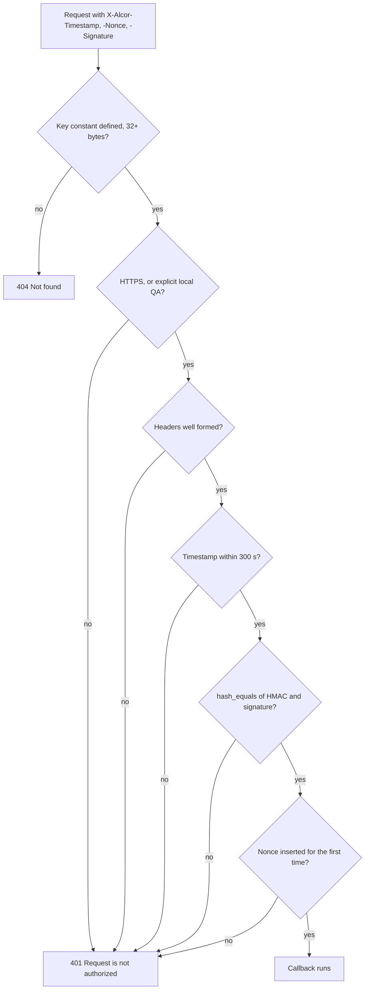
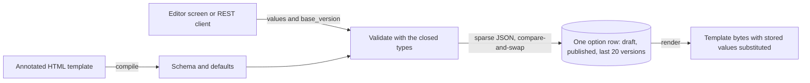

# AlcorWordPress: WordPress plugins with checked REST routes, signed service calls and hardening



Ten must-use plugins from the Alcor Industries site. They cover a client-editable content model with a REST API
(AlcorFields), HMAC authentication for server-to-server calls, four small hardening plugins, and the files that
search engines and AI agents read (sitemap, FAQ structured data, IndexNow key, agent catalog, OpenAPI). The plugins
that guard something fail closed: when their configuration is missing or their input is wrong, they refuse instead of
guessing.

`demo/` boots a fresh WordPress on [WordPress Playground](https://wordpress.github.io/wordpress-playground/), mounts
these plugins into it, and checks them over HTTP: refused anonymous calls, signed calls accepted, replayed and stale
calls refused, user names kept private.

## Why it's built this way

- **Every REST route has a `permission_callback`, and one function decides for all of a family.** WordPress treats a
  route without one as public. AlcorFields registers seven routes; the six per-document routes share
  `Alcor_Fields_REST::can()`, so the rule cannot drift between them. It asks questions from the cheapest to the most
  specific (signed in? allowed to use site content at all? does the document exist? is this document assigned to
  you?) and answers 401, 403, 404, 403 in that order. An anonymous caller gets 401 for every document key, real or
  invented, so the routes cannot be used to list which documents exist.
- **Signatures are compared with `hash_equals()`.** A plain `===` is free to stop at the first character that
  differs, so the time a refusal takes can tell a caller how many leading characters of a guessed signature were
  right. `hash_equals()` takes the same time wherever the strings differ.
- **A signature alone does not stop replay, so there is a clock window and a nonce table.** The signed string
  includes a timestamp and a nonce. The server refuses a timestamp more than 300 seconds from its own clock, in either
  direction, and records each nonce it accepts in a unique-keyed row, with one atomic `INSERT IGNORE`, so two
  concurrent copies of one request cannot both pass. The window is what makes the table small: a nonce can only be
  replayed while its timestamp is inside the window, so rows older than twice the window are deleted. The nonce is
  stored only after the signature verified, so a caller without the key cannot fill the table.
- **Fail closed, and say as little as possible.** With no key configured, a signed route answers `404`, the same as a
  route that does not exist. Every other failure is the same `401` with the same body, so a forger learns nothing
  about how close an attempt was. Plain HTTP is refused unless three things hold at once: an explicit constant, a
  `local` environment type, and a loopback client address. `security.txt` is not served at all when its configured
  contact is malformed, because a wrong reporting address is worse than none.
- **Closed field types, validated on the way in and escaped on the way out.** AlcorFields has five value types and no
  "raw HTML" type, so no role, including administrator, can store markup the template did not allow for. Writes carry
  the version that was edited and are a compare-and-swap on one database row, so two editors get a `409` conflict
  instead of a silent overwrite. An export carries a content hash, which detects damage but is not a signature;
  import validates every value again, exactly like an editor's save.
- **Core's defaults are replaced where they leak.** WordPress echoes any request `Origin` back with
  `Access-Control-Allow-Credentials: true` (`alcor-rest-cors.php` limits that to the site's own origin) and reveals
  login names through `/?author=1`, `/wp/v2/users`, oEmbed and feeds (`alcor-no-user-enumeration.php`). It also has no
  notion of a preview copy that must stay out of search (`alcor-preview-noindex.php` adds one).

## How it works

### Service-to-service authentication

A route opts in by calling `alcor_s2s_verify( $request, 'ALCOR_ORDERS_KEY' )` from its `permission_callback`. The
caller signs seven lines (method, route, sorted query, timestamp, nonce, body hash) with HMAC-SHA256. The exact format
is in the header of [`alcor-s2s-auth.php`](mu-plugins/alcor-s2s-auth.php).



[`examples/sign_request.py`](examples/sign_request.py) is a client for it (standard library only). The server file's
header cited a signer that lived in a private repository; this one is written for the showcase and the demo checks
that the request it produces is accepted.

### AlcorFields

A designer annotates an HTML page with `data-af-*` attributes. The annotations are the schema: a field exists
exactly where the page shows it, and its default is what the designer wrote. An editor, or a client of the REST API,
changes words, links, images, list items and optional sections, never markup.



| Route (`alcor-fields/v1`)       | What it does                                      |
| ------------------------------- | ------------------------------------------------- |
| `GET /documents`                | The documents the caller may edit                 |
| `GET /documents/<key>`          | Schema, live and draft content, version           |
| `POST /documents/<key>/draft`   | Save a draft (live page unchanged)                |
| `POST /documents/<key>/publish` | Publish the given values, or the current draft    |
| `POST /documents/<key>/restore` | Copy a published version into the draft           |
| `GET /documents/<key>/export`   | The hand-off file, bound to its content by a hash |
| `POST /documents/<key>/import`  | Validate a hand-off file and store it as a draft  |

The wp-admin screens (`class-alcor-fields-admin.php`) follow the same rules: a capability check and a nonce on every
action, plain forms that work without JavaScript, and a draft preview link that needs a login, permission for that
document and a nonce.

### The other plugins

| Plugin                          | Job                                                                                            |
| ------------------------------- | ---------------------------------------------------------------------------------------------- |
| `alcor-rest-cors.php`           | Core's CORS headers only for the site's own origin; a late pass strips what other code adds    |
| `alcor-no-user-enumeration.php` | Author redirects, REST user lookups, oEmbed and feeds no longer expose account names           |
| `alcor-security-txt.php`        | RFC 9116 `security.txt`; contact and expiry come from constants and are validated              |
| `alcor-preview-noindex.php`     | Loopback and `staging.`/`deploy.` hosts get `noindex`, and canonical links point to production |
| `alcor-agents.php`              | `/agents.json` catalog, OpenAPI 3.1 at `/openapi.json`, robots.txt groups for AI crawlers      |
| `alcor-faq-schema.php`          | `[alcor_faq]` prints the questions and the matching `FAQPage` JSON-LD from one list            |
| `alcor-public-sitemap.php`      | Lists code-served routes in the core sitemap; unknown sitemaps are 404, not the homepage       |
| `alcor-indexnow.php`            | Serves the IndexNow key file from a constant or option, never from source                      |

## Run it

Requirements: Node 20.18 or newer. The first start downloads the Playground CLI, WordPress and a PHP runtime, so it
needs network access and a few minutes; later starts reuse the cache. Playground runs PHP as WebAssembly, so give it
free memory.

PowerShell:

```powershell
Set-Location AlcorWordPress
node demo/run-demo.mjs
```

bash:

```bash
cd AlcorWordPress
node demo/run-demo.mjs
```

The script picks a free loopback port, generates passwords and keys for this run only, boots the site, prints one line
per check and exits `0` only if every check passed (`1` if a check failed, `2` if the site could not start). A
machine-readable copy of the outcome goes to `demo/out/results.json`. The pinned versions are at the top of
[`demo/lib/playground.mjs`](demo/lib/playground.mjs): Playground CLI 3.1.50, WordPress 7.1, PHP 8.4.

Sign a request by hand with the example client. The key goes in an environment variable, never on the command line.
`openssl rand -hex 32` and the .NET call below both produce a cryptographically secure random key.

PowerShell:

```powershell
$bytes = New-Object byte[] 32
[Security.Cryptography.RandomNumberGenerator]::Create().GetBytes($bytes)
$env:ALCOR_S2S_KEY = ($bytes | ForEach-Object { $_.ToString('x2') }) -join ''
python examples/sign_request.py --url "https://example.com/wp-json/acme/v1/status?region=eu"
```

bash:

```bash
export ALCOR_S2S_KEY="$(openssl rand -hex 32)"
python examples/sign_request.py --url "https://example.com/wp-json/acme/v1/status?region=eu"
```

The host in the URL is an example. The signature covers the route `/acme/v1/status` and the query `region=eu`, not
the host. The headers it prints are single-use and expire after five minutes.

To use the plugins on a site, copy `mu-plugins/*` into `wp-content/mu-plugins/` and set what you need in
`wp-config.php`:

| Constant                                                   | Plugin       | Meaning                                                                            |
| ---------------------------------------------------------- | ------------ | ---------------------------------------------------------------------------------- |
| `ALCOR_<NAME>_KEY` (32+ bytes)                             | s2s-auth     | Shared secret of one route family; the route names it in `alcor_s2s_verify()`      |
| `ALCOR_S2S_LOCAL_QA`                                       | s2s-auth     | `true` allows plain HTTP, only with environment type `local` and a loopback client |
| `ALCOR_SECURITY_TXT_CONTACT`, `ALCOR_SECURITY_TXT_EXPIRES` | security-txt | Contact URI and expiry; placeholders are served until you set them                 |
| `ALCOR_INDEXNOW_KEY` (or the `alcor_indexnow_key` option)  | indexnow     | 8 to 128 letters, digits and dashes                                                |
| `ALCOR_AGENTS_CONTACT_EMAIL`                               | agents       | Address in the agent catalog and the OpenAPI document                              |

## Read the code

| File                                                                                                                         | Look at first                                                                                |
| ---------------------------------------------------------------------------------------------------------------------------- | -------------------------------------------------------------------------------------------- |
| [`mu-plugins/alcor-s2s-auth.php`](mu-plugins/alcor-s2s-auth.php)                                                             | `alcor_s2s_verify()`: the order of the checks, and why the nonce is stored last              |
| [`mu-plugins/alcor-fields/src/class-alcor-fields-rest.php`](mu-plugins/alcor-fields/src/class-alcor-fields-rest.php)         | `can()`, the shared permission callback, and `guard()`, which maps failures to 409/422/500   |
| [`mu-plugins/alcor-fields/src/class-alcor-fields-store.php`](mu-plugins/alcor-fields/src/class-alcor-fields-store.php)       | `update()`: compare-and-swap on one row                                                      |
| [`mu-plugins/alcor-fields/src/class-alcor-fields-types.php`](mu-plugins/alcor-fields/src/class-alcor-fields-types.php)       | The five closed types; `inline()` rebuilds markup from a parse tree                          |
| [`mu-plugins/alcor-fields/src/class-alcor-fields-template.php`](mu-plugins/alcor-fields/src/class-alcor-fields-template.php) | `visit()` turns annotations into a schema; `repair()` keeps client content across a redesign |
| [`mu-plugins/alcor-fields/src/class-alcor-fields-html.php`](mu-plugins/alcor-fields/src/class-alcor-fields-html.php)         | The strict parser: it refuses ill-formed markup instead of repairing it                      |
| [`mu-plugins/alcor-rest-cors.php`](mu-plugins/alcor-rest-cors.php)                                                           | Origins compared as scheme, host and port; the late `PHP_INT_MAX` pass                       |
| [`demo/lib/checks.mjs`](demo/lib/checks.mjs)                                                                                 | The end-to-end checks, in the order a reader would try the attacks                           |
| [`demo/plugin/alcor-demo-fixtures/`](demo/plugin/alcor-demo-fixtures/)                                                       | The stand-ins the demo adds: a sample page template, two signed routes, a sitemap route      |

## Scope and limits

- **Left out of the private system:** everything that needs the site's theme, its payment and invoicing code, its
  internal services or its other products. What remains is the part that stands alone.
- **New for the showcase:** `examples/sign_request.py` (the original signer was private); the `[alcor_faq]` shortcode
  (the source kept the FAQ data list, and the markup and JSON-LD lived in the theme); the whole `demo/` folder.
- **Cut from `alcor-agents.php`:** the human-readable `/agents/` page, the list of sample sites and the free-app list,
  which need the theme. The catalog and the OpenAPI file describe a quote endpoint but do not implement one; point
  `alcor_agents_quote_path` at the route your site already has. Services are examples, replaceable with the
  `alcor_agents_services` filter. Hard-coded routes and page names in `alcor-public-sitemap.php` became the
  `alcor_public_routes` and `alcor_sitemap_noindex_paths` filters.
- **Changes while porting, beyond formatting and documentation:**
  - `alcor-rest-cors.php` removed core's callback before core had added it (core adds it inside `rest_api_init`), so
    only the late pass kept foreign origins out. It now removes it at `rest_api_init` priority 15 and calls core's
    function itself for the site's own origin and for requests without an Origin, which keeps core's `Vary: Origin`.
  - `Alcor_Fields_REST::can()` answered 404 for an unknown document before checking the login, which let an anonymous
    caller tell real document keys from invented ones. The order is now login, capability, existence, assignment.
  - `alcor-security-txt.php` called a function defined in `alcor-agents.php` and would have been a fatal error
    without it. It has its own helper now.
  - `alcor-preview-noindex.php` printed its own robots meta tag next to core's; it now uses core's `wp_robots`
    filter, and also hooks core's `get_canonical_url`, which replaces a theme-only filter.
  - Removed dead code (`Alcor_Fields_REST::doc()` re-assigned an empty array to itself), the hard-coded IndexNow
    key and the contact addresses.
  - Hard-coded names became configuration: the company name in oEmbed and feeds is now the site name (a filter
    brings a real byline back for one feed), the `security.txt` canonical URL follows `home_url()`, and the preview
    host prefixes are a constant.
  - Split the exception and node classes into their own files, one class per file.
- **How the port was checked:** the AlcorFields classes and the signing plugin were compared with the original as
  syntax trees, method by method, after normalising formatting, comments, braces and the operand order of equality
  tests. 211 units were identical; the differences are the ones listed above. The PHP was not executed during the
  port, so the demo is what exercises it.
- **Not covered by the demo:** the wp-admin screens and `admin.js` (no browser is driven), the `max_input_vars`
  fallback, and concurrent requests. The demo's database is SQLite, translated from MySQL by Playground's driver; the
  nonce table uses MySQL's `INSERT IGNORE`, which that driver maps to SQLite's `INSERT OR IGNORE`.
- **Tests from the source:** the AlcorFields acceptance suite is not included. It drives a browser against 22 sample
  sites, the private theme and a baseline checkout inside a pinned container, so it does not run on stock WordPress.
  `demo/` replaces it for the REST behaviour.
- **Not offline:** the demo needs the npm registry and WordPress downloads on its first start. After that the site
  runs from the local cache. Neither WordPress nor the Playground CLI is part of this folder.

Extracted from the Alcor system; the theme, the internal ERP signer and the sample-site registry were replaced by a
fixture plugin, a Python example signer and filters.
