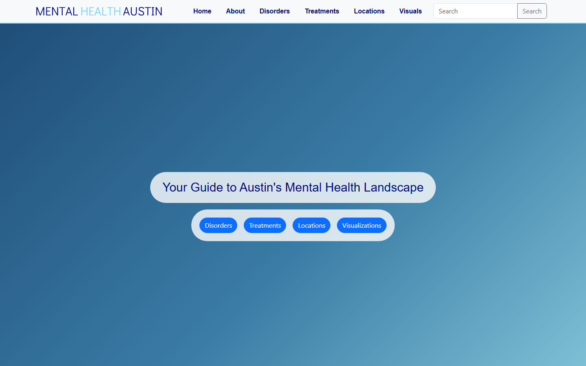

# Mental Health Austin

Mental Health Austin is a website that helps Austin residents find mental-health information and
care. It connects **disorders**, the **treatments** used for them, and the **local care locations**
that offer those treatments: every disorder links to the treatments and places that address it,
and the other way round. Locations are shown on an OpenStreetMap map.



This was a five-person team project for **UT Austin Software Engineering, fall 2023**: a React
frontend, a Flask REST API and an SQL database, with unit, API and browser acceptance tests.

## Team

| Name |
|---|
| Omar Abouelazm |
| Cole Brown |
| Alex Morales |
| Ryan Park |
| Adonay Tesfaye |

All five members built the project together; see [NOTICE.md](NOTICE.md) for copyright and data sources.

### Cole Brown's contributions

- Site-wide search and per-model search (disorders, treatments, locations) using fuse.js fuzzy matching, with highlighting of matched text in the results.
- The GitLab CI/CD pipeline and the fixes needed to get the AWS deployment working.
- The Jest unit tests and the Selenium acceptance tests.
- The navbar, the About page and the team statistics cards.

## How it works

- **Frontend:** React 18 (Create React App), React Router, Bootstrap, fuse.js, react-leaflet / Leaflet with OpenStreetMap tiles, recharts and chart.js.
- **Backend:** a Flask and SQLAlchemy REST API in `backend/API`, with endpoints such as `/get_all_disorders/` and `/get_disorder/?name=...`. Data is loaded from JSON under `backend/data`.
- **Tests:** Jest and React Testing Library (frontend), `unittest` (API) and Selenium (acceptance, in `acceptance_tests/`).
- **Deployment:** the team ran the React frontend and the Flask API on AWS, with MySQL on Amazon RDS, Dockerized and deployed by GitLab CI. Locally it runs with SQLite and needs no accounts, keys or cloud services.

Diagrams: [UML diagram](UML_Diagram_Updated.PNG) and [model diagram](Model_Diagram.PNG).

```
backend/API        Flask app, ORM models, seed.py, API unit tests
backend/data       JSON data loaded by seed.py
backend/scrapers   Data-collection scripts and notebook (credentials not included)
src                React app (pages, tiles, tests)
acceptance_tests   Selenium tests
```

## Run it

You need Python 3.10+, Node.js 18+ and npm.

### 1. Seed the database and start the API

```bash
cd backend/API
pip install -r requirements.txt
python seed.py          # loads backend/data into SQLite (mha.db)
python app.py           # serves http://127.0.0.1:5000
```

Environment variables (all optional):

| Variable | Default | Purpose |
|---|---|---|
| `DATABASE_URL` | `sqlite:///mha.db` | SQLAlchemy database URL |
| `PORT` | `5000` | API port (binds to 127.0.0.1) |

Try it: `curl http://127.0.0.1:5000/get_all_disorders/` or `curl "http://127.0.0.1:5000/get_disorder/?name=Vaginismus"`.

### 2. Start the frontend

```bash
npm ci
REACT_APP_API_URL=http://127.0.0.1:5000 npm start    # http://localhost:3000
```

`REACT_APP_API_URL` defaults to `http://127.0.0.1:5000`. For a production bundle, run `npm run build`
and serve the `build/` folder with any static file server.

Map tiles come from OpenStreetMap and need internet access; everything else works offline.

## Tests

```bash
npx jest                              # frontend unit tests
cd backend/API && python seed.py && python unit_tests.py   # API tests (needs the seeded database)
```

The Selenium tests in `acceptance_tests/` need Chrome and a running site; set `SITE_URL` to point at it
(default `http://127.0.0.1:3000/`).

## Data

- Disorder and treatment information was collected from public sources: the WHO ICD API, Wikipedia,
  DailyMed and the NHS.
- **Location data came from public business listings** (name, address, hours, phone number, rating and
  coordinates of mental-health providers around Austin). The joined data the app uses is in
  `backend/data/connections`. The scripts in `backend/scrapers` show how it was gathered; they need
  your own API credentials, and their intermediate outputs are not included.
- Treatment descriptions and links belong to their original publishers.
