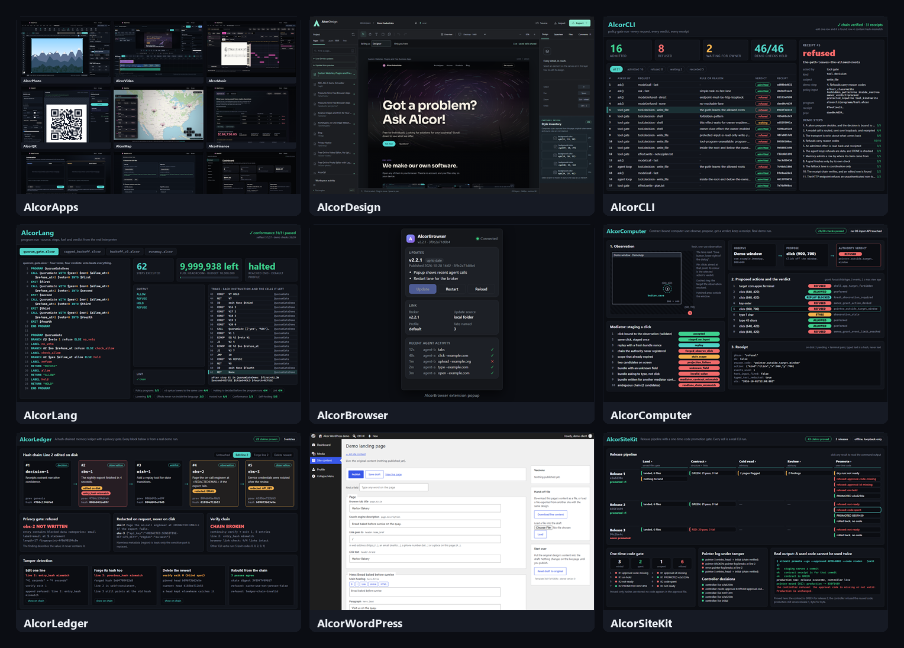
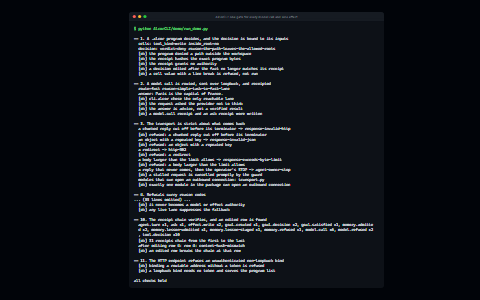
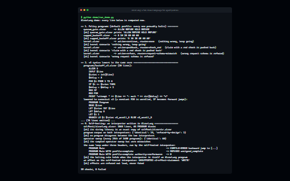
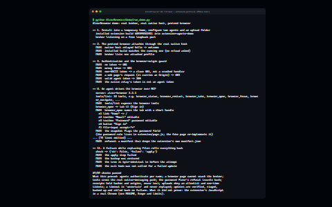
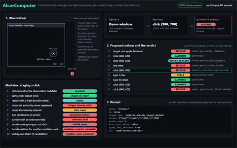
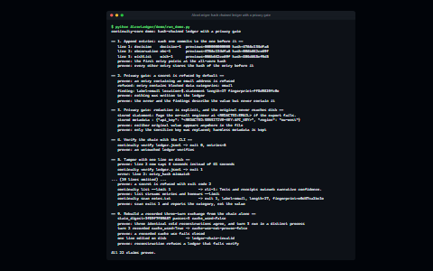
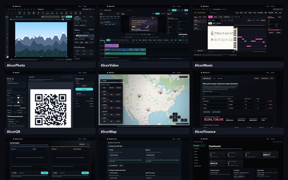
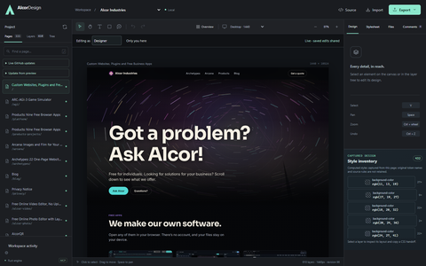
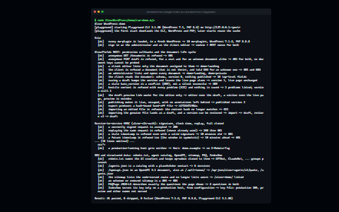
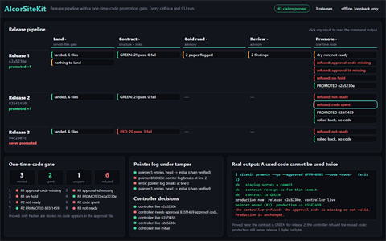

# AlcorShowcase

Selected work by **Cole Brown** from [Alcor Industries](https://alcor-industries.com/): the agent
infrastructure, browser apps and web tooling behind a one-person software company, packaged to run
standalone.



Every component runs on a clean machine with no outside services, and each one ships an offline
end-to-end demo alongside its tests. `python scripts/check.py` runs all of them.

## Components

### Agent infrastructure

| | Component | What it is |
|---|---|---|
|  | [**AlcorCLI**](AlcorCLI) | The single gate between an agent and the world: every model call and side effect is routed, admitted or refused by policy, and leaves a receipt. Python. |
|  | [**AlcorLang**](AlcorLang) | `.alcor`, a small fail-closed language for agent policies: interpreter, linter, lowering to Python and C, a conformance corpus and a self-hosted interpreter. Python. |
|  | [**AlcorBrowser**](AlcorBrowser) | Lets AI agents drive a real, signed-in Chrome over MCP: a Manifest V3 extension plus a local broker, with per-agent tokens, receipts, password and CAPTCHA floors, and SHA-256-verified self-updates with rollback. JavaScript + Python. |
|  | [**AlcorComputer**](AlcorComputer) | A contract-bound computer-use mediator: clicks and typing only through observations an authority produced, replay protection, sanitized receipts, real macOS and Windows backends. Python. |
|  | [**AlcorLedger**](AlcorLedger) | A hash-chained, append-only ledger for agent memory with a privacy gate that refuses or redacts secrets before they are written. Python. |

### Products and web

| | Component | What it is |
|---|---|---|
|  | [**AlcorApps**](AlcorApps) | Nine free, local-first browser apps: a PSD-reading photo editor, a 12-track video editor, a music editor with MIDI/MusicXML/WAV export, QR, maps, finance, offline translation, exact-decimal CSV reconciliation and an ERP. Plain JavaScript, no build step. |
|  | [**AlcorDesign**](AlcorDesign) | A Figma-like design editor for real websites, written in Rust, with the same edits exposed to AI agents as MCP tools. The company site was built in it. |
|  | [**AlcorWordPress**](AlcorWordPress) | Production WordPress plugins: REST APIs with permission callbacks, HMAC service-to-service auth with replay protection, hardening and structured data. PHP. |
|  | [**AlcorSiteKit**](AlcorSiteKit) | The site's release tool: land, contract tests, visual baseline and an LLM review, then promotion to production only through a strict, one-time-code gate. Python + Node. |

### Team project

| | Project | What it is |
|---|---|---|
|  | [**Mental Health Austin**](MentalHealthAustin) | A five-person UT Austin software-engineering project (fall 2023): React + Flask + MySQL, connecting disorders, treatments and local care. Credited to the whole team; see its README. |

## Run it

```bash
python scripts/check.py            # every component's tests and demos
python scripts/check.py AlcorLang  # one component
```

Python 3.10+ for the Python components; Node 20+ for the JavaScript tooling; Rust for AlcorDesign.
Each component's README has its own "Run it" section.

- [**Evidence**](evidence/README.md): index and cascade results re-runnable from this repo; recovery raw trials inspectable; behind the numbers in the résumé, each with its command, figures and limits.

## About

Built by Cole Brown (Austin, TX), B.S. Computer Science, UT Austin. Much of this system was written
with AI coding agents working under the rules and gates you can read in AlcorCLI and AlcorLang.
[LinkedIn](https://www.linkedin.com/in/cole-brown-286a8721b/) ·
[alcor-industries.com](https://alcor-industries.com/)

See [LICENSE](LICENSE): all rights reserved; free to read and run for evaluation.
